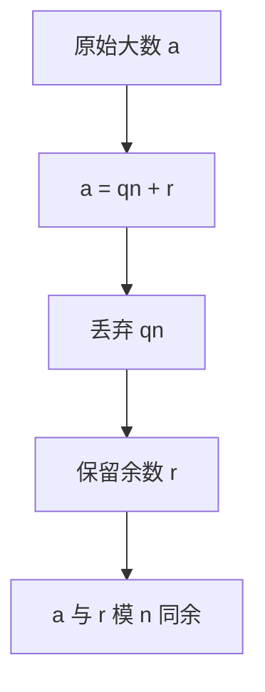
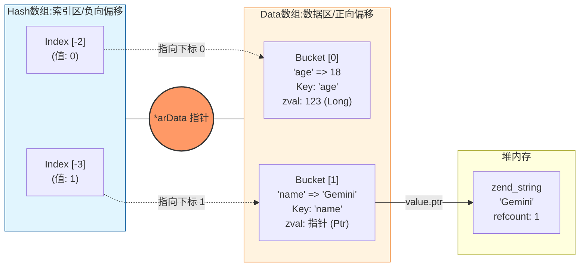
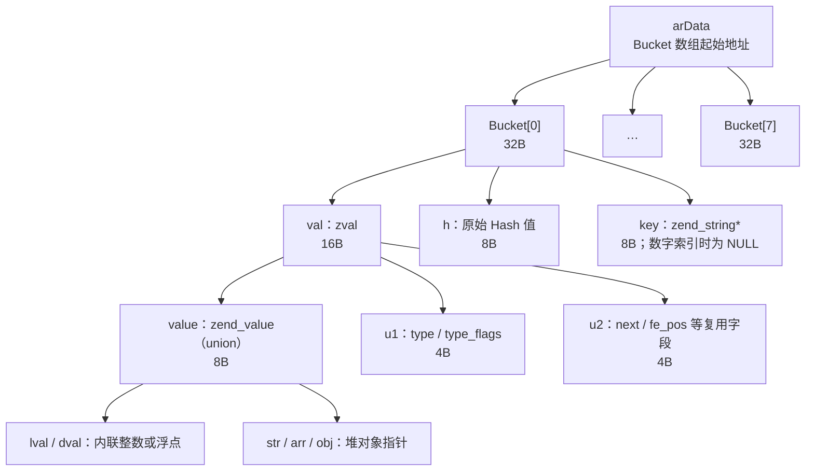
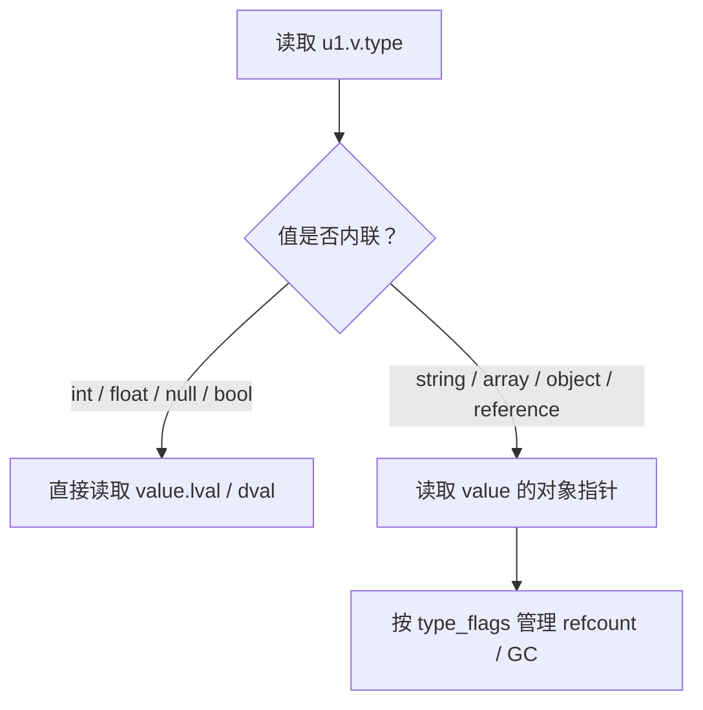

---
{"dg-publish":true,"permalink":"/Learn/Hash算法与数据库实现/","title":"Hash算法与数据库实现","tags":["flashcards"],"noteIcon":"","created":"2026-09-07T10:50:45.000+08:00","updated":"2026-11-17T16:42:24.053+08:00","dg-note-properties":{"title":"Hash算法与数据库实现","tags":["flashcards"]}}
---

# Hash函数
### Hash 函数的作用
* **功能**：将**任意长度的输入** 通过 Hash 算法转换成**固定**长度的输出（即 Hash 值）。
* **特性**：这是一种**压缩**映射。Hash 值的空间远小于输入的空间，因此**不同的输入可能**散列成**相同**的**输出**，这种现象称之为**冲突**，且**不能**从 Hash 值唯一确定输入值。
<?e?>
### Hash 函数的要求 (理想情况)
一个好的 Hash 函数应该满足：
* **均匀分布**：每个关键字都能均匀地分布到 Hash 表的任意位置。
* **无冲突**：与 Hash 表中已有的关键字**不发生冲突**。
> **注意**：实现一个完全无冲突的 Hash 函数是极具挑战性的。
# 取模算法（Modulo Operation）
### 1. 定义与公式
取模运算返回两数相除后的**余数**。
- **数学表示**：$a \bmod n = r$
- **通用公式**：==1;;$r = a - (n \times \lfloor a / n \rfloor)$== 其中 $\lfloor x \rfloor$ 是向下取整函数。
	- **a (Dividend)**: 运算起点，代数基础变量。
	- **n (Modulus)**: 拉丁语 *Modulus* (标准)，表示周期的步长。
	- **q (Quotient)**: 拉丁语 *Quotiens* (次数)，表示包含多少个 $n$。
	- **r (Remainder)**: 拉丁语 *Remanere* (残留)，表示除去完整周期后的余量。
- **位运算替代**：当除数 $n$ 是 $2$ 的幂次（如 $2, 4, 8, 16...$）时：优化公式：`a % n == a & (n - 1)`，原因：按位与（AND）比除法指令快得多。
<!--SR:!2026-11-29,150,234-->
<?e?>
### 2. 负数取模的差异
| **类型**               | **代表语言**             | **公式**                                     | **示例 (−7mod3)**                  | **结果符号**      |
| -------------------- | -------------------- | ------------------------------------------ | -------------------------------- | ------------- |
| **截断取整** (Truncated) | C, Java, Php, Go, JS | 使用 `(int)(a/n)` 这种==1;;向零取整==的方式。          | $-1$                             | 与==1;;被除数==一致 |
| **地板取整** (Floored)   | Python, Ruby         | 使用$\lfloor a / n \rfloor$这种==1;;向下取整==的方式。 | $2$（因为 $-7 = 3 \times (-3) + 2$） | 与==1;;除数==一致  |

为什么 Python 中 $-7 \bmod 3 = 2$？<?:?> 因为 Python 向下取整，$-7 / 3 \approx -2.33 \rightarrow -3$。公式计算：$-7 - (3 \times -3) = 2$。
<!--SR:!2027-01-13,198,273-->
<?e?>
### 3. 核心算法性质
在处理大数运算（如加密算法）时，以下性质至关重要：
- **加法**：$(a + b) \bmod n = ((a \bmod n) + (b \bmod n)) \bmod n$
- **乘法**：$(a \times b) \bmod n = ((a \bmod n) \times (b \bmod n)) \bmod n$
- **幂运算**：$a^b \bmod n = (a \bmod n)^b \bmod n$
这些是**模运算的同余性质**，不是某个单独的算法。通常约定 $n > 0$；至少必须满足 $n \ne 0$。
#### 先理解：只保留余数，不改变模 $n$ 下的结果
先把抽象字母换成具体数字：令 $a=23$、$n=5$。计算 $23 \bmod 5$，就是问「23 个单位能分成多少组完整的 5，还剩多少？」
1. 可以分成 $4$ 组完整的 $5$：$4 \times 5=20$。这里的 $4$ 就是商 $q$。
2. 从 $23$ 中拿走这 $20$ 个单位后，剩下 $3$。这里的 $3$ 就是余数 $r$。
3. 所以 $23=4 \times 5+3$，也就是 $a=qn+r$；同时 $23 \bmod 5=3$。
这里的 $q$ 只表示「拿走了多少个完整的 $n$」，而 $r$ 才是取模最终保留的结果。
`23` 和 `3` 在普通整数意义下当然**不相等**，但它们相差 $20$，而 $20=4 \times 5$ 是 $5$ 的整数倍。对两者取模 $5$，结果都为 $3$：
$$23 \bmod 5=3 \qquad 3 \bmod 5=3$$
因此记作 $23 \equiv 3 \pmod 5$，读作「23 与 3 模 5 同余」。符号 $\equiv$ 不是普通的等号；它表示两个数**除以 5 后余数相同**。
同样，$8 \equiv 3 \pmod 5$、$13 \equiv 3 \pmod 5$、$18 \equiv 3 \pmod 5$，因为它们都比 $3$ 多了若干个完整的 $5$。

#### 加法与乘法为什么成立
设 $a = q_1n + r_1$、$b = q_2n + r_2$，其中 $r_1 = a \bmod n$、$r_2 = b \bmod n$。
- **加法拆解：** $a+b=(q_1+q_2)n+(r_1+r_2)$。第一部分是 $n$ 的倍数，取模后只剩 $(r_1+r_2)\bmod n$。
- **乘法拆解：** $ab=(q_1n+r_1)(q_2n+r_2)=q_1q_2n^2+q_1nr_2+q_2nr_1+r_1r_2$。前三项都是 $n$ 的倍数，取模后只剩 $r_1r_2\bmod n$。
#### 幂运算如何拆解
当 $b$ 是非负整数时，$a^b$ 就是 $b$ 个 $a$ 相乘。每次相乘后立刻取模，依据乘法性质不会改变最终余数：
$$a^b \bmod n = \underbrace{(a \bmod n) \times \cdots \times (a \bmod n)}_{b\text{ 次}} \bmod n$$
例如计算 $3^{13} \bmod 7$，先将指数拆成二进制：$13=8+4+1$。

| 步骤 | 计算 | 模 $7$ 的结果 |
| :-- | :-- | :-- |
| 初始 | $3$ | $3$ |
| 平方 | $3^2$ | $2$ |
| 再平方 | $3^4=(3^2)^2$ | $4$ |
| 再平方 | $3^8=(3^4)^2$ | $2$ |
| 合并 $8+4+1$ | $3^8 \times 3^4 \times 3$ | $2 \times 4 \times 3 \bmod 7=3$ |

这就是**快速幂（重复平方法）**：
- 不断平方底数；指数的当前二进制位为 $1$ 时，才把该底数乘入结果。时间复杂度从朴素做法的 $O(b)$ 降为 $O(\log b)$。
上面的手算与下面的 PHP **是同一件事**：
- 手算时主动把 $13$ 写成 $8+4+1$；代码则通过不断右移二进制的 `1101`，自动找出这三个为 $1$ 的位。
- 代码不会真的计算完整的 $3^{13}$，而是只计算并保留 $3^1$、$3^2$、$3^4$、$3^8$ 在模 $7$ 下的余数。
```php
function modPow(int $base, int $exponent, int $modulus): int
{
    if ($modulus <= 0 || $exponent < 0) {
        throw new InvalidArgumentException('modulus 必须大于 0，exponent 必须为非负整数');
    }

    // result 累积“指数二进制位为 1”的幂；开始时还没有选中任何幂。
    $result = 1 % $modulus;
    // base 依次表示 a^1、a^2、a^4、a^8 ... 取模后的结果。
    $base = (($base % $modulus) + $modulus) % $modulus;
    while ($exponent > 0) {
        // 检查当前最低位：1 表示选中当前 base，0 表示跳过它。
        if ($exponent & 1) {
            // 对应手算中把 3^1、3^4、3^8 乘入最终结果。
            $result = ($result * $base) % $modulus;
        }
        // 底数平方：3^1 -> 3^2 -> 3^4 -> 3^8。
        $base = ($base * $base) % $modulus;
        // 右移一位，继续检查指数的下一位二进制数字。
        $exponent >>= 1;
    }

    return $result;
}
```
以 `modPow(3, 13, 7)` 为例，循环与手算的对应过程如下：

| 循环开始时的 `exponent` | 最低二进制位 | 当前 `base` | 代码动作 | `result` |
| :-- | :-- | :-- | :-- | :-- |
| `13`（`1101`） | `1` | $3^1 \bmod 7=3$ | 选中 $3^1$ | $1 \times 3 \bmod 7=3$ |
| `6`（`110`） | `0` | $3^2 \bmod 7=2$ | 跳过 $3^2$ | $3$ |
| `3`（`11`） | `1` | $3^4 \bmod 7=4$ | 选中 $3^4$ | $3 \times 4 \bmod 7=5$ |
| `1`（`1`） | `1` | $3^8 \bmod 7=2$ | 选中 $3^8$ | $5 \times 2 \bmod 7=3$ |

所以 `if ($exponent & 1)` 就是「这个 $2$ 的幂是否出现在 $13=8+4+1$ 里」；`$base = ($base * $base) % $modulus` 就是手算表中的“再平方”。
#### 使用边界
- **负指数：** $a^{-b} \bmod n$ 不能直接套用上式；必须先求 $a$ 的模逆元，且仅当 $\gcd(a,n)=1$ 时模逆元存在。
- **负数底数：** 数学上可先规范化为 $((a \bmod n)+n)\bmod n$；部分语言的 `%` 返回负余数，不能直接假设结果落在 $0$ 到 $n-1$。
- **固定宽度整数：** 先取模能控制数值增长，但 `result * base` 仍可能先溢出；密码学实现应使用大整数或安全的模乘算法（如 Montgomery multiplication），不能只依赖普通整数乘法。
### 4. 典型应用场景
- **循环/环形结构**：当一个数字不断增长，但你希望它在一个范围内循环（比如 $0$ 到 $11$ 代表月份），可以使用 `index = count % 12`。
- **奇偶判断**：`n % 2 == 0` 为偶数，`n % 2 != 0` 为奇数。
- **哈希散列**：在哈希表中，通过 `hash(key) % table_size` 将任意大的键值映射到有限的数组索引中。
- **单位换算**： 例如将秒数转换为分秒：`minutes = total_seconds / 60`，`seconds = total_seconds % 60`。
<?e?>
# Hash算法
## 概念
Hash 算法（散列函数）将关键字 $k$ 映射到 Hash 表中的一个存储地址 $h(k)$。关键字 $k$ 可以是**整数**或**字符串**。
### Hash 冲突 (Collision)
不同的关键字 $k_1 \ne k_2$ 经过 Hash 算法计算后得到相同的地址 $h(k_1) = h(k_2)$。
### Hash 表的装填因子 ($\alpha$)
衡量 Hash 表被**填满程度**的指标。$\alpha$ 越大，Hash 冲突的概率越**高**，查找效率越**低**，公式：$\alpha = \frac{\text{表中已存关键字个数 } n}{\text{Hash 表的长度 } m}$
- **理想状态：** 每个键都映射到不同的索引，没有冲突，此时查找时间复杂度是 $O(1)$。
- **现实状态：** 随着装填因子 $\alpha$ 的增加（即存储的数据越来越多），多个键映射到同一个索引的概率（**哈希冲突**）呈**指数**级上升。
<?e?>
## 整数关键字的 Hash 算法
### 直接取余法 (Division Method)
- **原理:** 直接用关键字 $k$ 除以 Hash 表的大小 $m$ 取余数。
- **公式:** $h(k) = k \mod m$
- **示例:** 如果 Hash 表大小 $m = 12$，关键字 $k = 100$，则 $h(k) = 100 \mod 12 = 4$。
- **优点:** 算法简单，只需要一个求余操作，速度快。
- **缺点:** 对 $m$ 的选择很敏感。通常建议 $m$ 选择一个==1;;素数（质数）==，且不能接近 ==1;;$2^p$== 或 $10^p$。
> [!QUESTION]- $m$ 接近 $10^p$ 的情况
> 如果关键字 $k$ 是以十进制表示的，**且 $k$ 的变化主要集中在较高的数位上**（例如，员工 ID $10001, 10002, 20001, 20002$），
> 而 Hash 表大小 $m$ 是 $10^p$（例如 $m=1000=10^3$，此时 $p=3$），计算 $k \mod 1000$ 得到的结果就是 $k$ 的**后三位数**。这种情况下，
> 不同的高位（如 $1111$ 和 $10111$）会被映射到相同的结果（$111$），同样会 **导致 Hash 冲突**。
- **总结：** $p$ 在这里代表的是幂指数，用来强调 Hash 表大小 $m$ 不应是某些数的整数幂次，以避免 Hash 地址仅仅依赖于关键字 $k$ 的低位，从而降低冲突率。因此，**直接取余法推荐使用一个素数作为 $m$**。
<!--SR:!2027-08-29,325,250-->
<?e?>
#### 速度对比和原理
##### 1. 模运算 (`%`)
* **表达式:** $hash\_value \% HASH\_TABLE\_SIZE$
* **速度:** 相对较**慢**。
* **原理:** 模运算（取余）在底层 CPU 中通常需要执行一个整数**除法**指令是CPU上最**慢**（通常比加法、乘法、位移慢几个数量级）的基本算术操作之一。它适用于任何正整数的 `HASH_TABLE_SIZE`。
##### 2. 位与运算 (`&`)
* **表达式:** $hash\_value \ \& \ (HASH\_TABLE\_SIZE-1)$
* **前提条件:** `HASH_TABLE_SIZE` **必须**是 $2^N$ (如 $1024, 2048, 4096$)。
* **速度:** 极**快**。
* **原理:** 位与操作是 CPU 上最**快**的位操作指令之一。
    * 当 $M$ 是 $2^N$ 时，`M - 1` 的二进制表示是 $N$ 个连续的 `1` (例如 $1024 - 1 = 1023$，二进制是 $1111111111_2$)。
    * 对一个数 $X$ 进行 $X \ \& \ (2^N - 1)$ 操作，实际上就是保留 $X$ 的**最低 $N$ 位，并将所有更高的位清零**。
    * 数学上，保留**最低 $N$ 位**与对 $2^N$ 取模的效果是完全**相同**的。因此，它用一个极其快速的位操作完成了原本复杂的整数除法，实现了性能上的巨大提升。
##### 结论
| 表达式                        | 适用条件           | 速度    | 底层操作        |
| :------------------------- | :------------- | :---- | :---------- |
| **$hash\_value \% M$**     | 适用于任何 $M > 0$  | **慢** | 整数除法 (代价高)  |
| **$hash\_value \& (M-1)$** | 仅适用于 $M = 2^N$ | **快** | 位与操作 (代价极低) |

<?e?>
### 乘积取整法 (Multiplication Method)
* **原理:** 将关键字 $k$ 乘以一个**常$A$（$0 < A < 1$）数**，提取乘积 $kA$ 的==1;;小数==部分，再乘以Hash 表的大小 ==1;; $m$== 并向==1;;下==取整。
* **公式:** ==1;;$h(k) = \lfloor m (kA \mod 1) \rfloor$== 其中，$kA \mod 1$ 表示 $kA$ 的==1;;小数==部分。
- **优点:**
	- 对 $m$ 的选择不那么敏感，$m$ 可以是==1;;任意==值（通常取 $2^p$ 便于计算机进行位运算计算）。
	- Hash 结果与关键字 $k$ 的所有位都有关系。
- **缺点:**
	- **需要浮点数运算**：在计算 $k \cdot A$ 时涉及浮点数乘法，这在早期的硬件上或某些嵌入式系统中可能比整数运算（如直接取余法）==1;;慢==。
	- **常数 $A$ 的选取**：算法性能很大程度上依赖于常数 $A$ 的选取。虽然有推荐值（如**黄金分割率倒数**==1;;$A \approx 0.6180339887$==），但选择不当仍可能导致冲突。
	- **精度问题**：浮点数的精度限制（特别是在使用单精度浮点数时）可能导致散列值的微小偏差，影响散列的均匀性。
#### 代码实例
```c
#include <stdio.h>
#include <math.h>

// 推荐常数 A：黄金分割率的倒数
#define A_CONSTANT 0.6180339887

/**
 * 乘积取整法 Hash 函数
 * @param key 关键字 (整数)
 * @param m Hash 表的大小
 * @return int Hash 表的地址 (0 到 m-1)
 */
int multiplicationHash(int key, int m)
{
    // 提取小数部分 (kA mod 1)：fmod(kA, 1.0) 计算 kA 除以 1.0 的余数，即小数部分。「或者使用 kA - floor(kA);」
    return (int)floor(m * fmod((double)key * A_CONSTANT, 1.0));
}

int main()
{
    // 假设 Hash 表大小为 m=1000
    int m = 1000;
    // 示例关键字
    int keys[] = {12345, 98765, 42};
    /* 解释：
     * sizeof(keys) 返回整个数组占用的字节数：数组包含 3 个元素，每个元素类型为 int（在常见平台上为 4 字节），因此整个数组大小为 3 * 4 = 12 字节。
     * sizeof(keys[0]) 返回数组第一个元素的字节数，即 sizeof(int)，通常为 4。
     * 注意：当数组传入函数时会退化为指针（array-to-pointer decay），在函数内部对参数使用 sizeof 会得到指针大小（例如 8），而不是数组总大小。
     */
    int num_keys = sizeof(keys) / sizeof(keys[0]);
    printf("--- 乘积取整法 Hash 示例 (m=%d) ---\n", m);
    for (int i = 0; i < num_keys; i++)
    {
        int hash_address = multiplicationHash(keys[i], m);
        printf("Key: %d -> Hash Address: %d\n", keys[i], hash_address);
    }
    return 0;
}
```
示例输出 (可能的运行结果):
```
--- 乘积取整法 Hash 示例 (m=1000) ---
Key: 12345 -> Hash Address: 629
Key: 98765 -> Hash Address: 126
Key: 42 -> Hash Address: 957
```
<!--SR:!2026-11-26,28,190-->
<?e?>
## 字符串关键字的 Hash 算法
当关键字是字符串的时候，需要先将所有字符的**ASCII码**转成整数，然后再使用整数关键字的Hash算法
### Times33 (T33 / DJB Hash)
#### 核心原理
Times33 算法是一种基于加权**累加**的迭代算法。它将字符串 $S = s_0s_1s_2...s_{n-1}$ 视为一个以**33**为基数的数字，其中每个字符的 ASCII 值 $s_i$ 是该数字的一位。
* **迭代公式（核心）：**$H_{i} = H_{i-1} \times 33 + \text{ASCII}(s_i)$
* **初始值：** $H_0$ 通常设置为 **5381**（一个奇素数）因为它能提供更**均匀**的分布。
* **乘 33 的高效实现：** 在二进制中，乘以 33 可以通过**位**运算高效实现：$H_{i-1} \times 33$ = $H_{i-1} \times (32 + 1)$ = $(H_{i-1} \ll 5) + H_{i-1}$
* **优点:** 运算简单，速度快，在实际应用中（如 SDBM、Apache、PHP）表现出良好的散列特性。
#### 使用场景
| **需求维度**       | **适用程度** | **核心原因（为什么使用）**                                                  | **潜在风险（为什么不适用）**                                                      |
| -------------- | -------- | ---------------------------------------------------------------- | --------------------------------------------------------------------- |
| **追求计算速度**     | **极度适用** | **指令级优化**：仅需位移（`<< 5`）和加法，不依赖昂贵的硬件乘法器，CPU 周期消耗极低。                | **过于简单**：在现代高性能 CPU 上，虽然快，但相比 MurmurHash3 等算法，它缺乏复杂的位混淆步骤。            |
| **短字符串随机化**    | **非常适用** | **ASCII 亲和力**：初始值 **5381** 配合乘数 `33` 能迅速扩散短字符（如变量名、URL）的差异，分布均匀。 | **规律性数据**：如果输入是具有极强数学规律的序列（如纯数字递增），可能会出现局部聚簇。                         |
| **处理超长文本**     | **不推荐**  | **无**                                                            | **高位溢出丢失**：长文本前面的字符信息会因多次位移从寄存器左侧溢出，导致哈希值只取决于末尾文本，碰撞率激增。              |
| **抗碰撞攻击 (安全)** | **禁止使用** | **无**                                                            | **确定性危机**：算法固定且线性，攻击者可轻易构造大量哈希值相同的字符串，触发“哈希洪水攻击”使服务瘫痪。                |
| **分布式负载均衡**    | **基本适用** | **计算一致性**：算法实现简单，各语言版本一致，能确保同一个 Key 始终映射到同一个节点。                  | **节点倾斜**：若 Key 的特征分布不均，简单的 Times33 可能导致某些节点压力过大，不如一致性哈希配合 MurmurHash。 |
```c
/**
 * DJBHash - 字符串 Hash 算法 (Times33)
 * @param str 要计算 Hash 值的字符串
 * @return unsigned int 计算得到的 Hash 值
 */
unsigned int DJBHash(char *str)
{
    // 初始种子值，常用奇素数 5381。
    unsigned int hash = 5381;
    // 循环遍历字符串，直到字符串结束符 '\0'。
    while (*str)
    {
        // 核心计算: hash = hash * 33 + 字符ASCII码
        // hash << 5 即 hash * 32。利用位运算实现高效乘 33。
        // *str++ 获取当前字符并使指针前进。
        hash += (hash << 5) + (*str++);
    }
    // 返回非负值：清除最高位，确保结果为正数。
    return (hash & 0x7FFFFFFF);
}

int main()
{
    char *test_str = "Hello, World!";
    unsigned int hash_value = DJBHash(test_str);
    printf("DJBHash of \"%s\" is: %u\n", test_str, hash_value); // DJBHash of "Hello, World!" is: 383943310
    return 0;
}
```
<?e?>
#### 初始值 0 vs 5381
这是一个关于哈希算法初始化值（Seed）的经典问题，特别是针对 **Times33**（或称为 ==1;;DJB2== 算法）。
在 Times33 算法中，初始值（Seed）对**哈希分布**影响很大。对于 `0` 和 `5381` ，==1;;5381== 使哈希值分布更==1;;均匀==，是更好的选择。
以下是对比和原因的详细解释：
##### 1. 初始值 $\text{hash} = 0$
如果将初始哈希值设置为 $0$，则：
* **第一次迭代**：$\text{hash} = 0 \times 33 + \text{char}_1 = \text{char}_1$。
这导致生成的哈希值**严重依赖**==1;;第一个==字符的 ASCII 值。如果输入字符串的第一个字符相同，那么在第一次迭代之后它们的哈希值就是相同的，这会增加在哈希表中的碰撞概率，尤其是在键值相似的情况下。
##### 2. 初始值 $\text{hash} = 5381$ (推荐)
$5381$ 是一个经验上被证明效果非常好的初始值（或称为魔法数字）。它在 DJB2 算法中被广泛采用。
* **原因 1：引入随机性**：$5381$ 是一个较大的素数，它为哈希计算提供了一个高位非==1;;零==的初始状态，立即打破了哈希值对第一个字符的简单依赖。
* **原因 2：利用乘法特性**：
$$\text{hash} = \text{hash} \times 33 + \text{char}$$
当 $\text{hash}$ 已经是一个大数值（如 $5381$）时，乘法操作会更有效地将输入字符的位分布散布到哈希值的各个位上，从而获得更==1;;均匀==的分布。
##### 💡举例说明
以 **`"abc"`** / **`"abd"`** 为例（前缀 `"ab"` 相同、仅末字符不同），统一对比两种 seed 的逐步计算（Hash 表 $m = 128$）：

| 步骤 ($i$) | 字符 ($s_i$) | ASCII | **seed = 0** $H_i$ | 有效位 | **seed = 5381** $H_i$ | 有效位 |
| :--------: | :--------: | :---: | -----------------: | :----: | --------------------: | :----: |
| **0 (Init)** | - | - | 0 | 0 | 5381 | 13 |
| **1 ('a')** | 'a' | 97 | 97 | 7 | 177670 | 18 |
| **2 ('b')** | 'b' | 98 | 3299 | 12 | 5863208 | 23 |
| **3 ('c')** | 'c' | 99 | 108966 | 17 | 193485963 | 28 |
| **3 ('d')** | 'd' | 100 | 108967 | 17 | 193485964 | 28 |
* **第 1 步 — 退化 vs 打散**：
	* $seed=0$ 时 $H_1 = 0 \times 33 + 97 = 97$，直接退化为**首字符 ASCII**，仅 7 bit（97=1100001）；
	* $5381$ 时 $H_1 = 177670$（18 bit），从第一步起高位就参与后续混合。
* **第 2 步 — 基数决定混合深度**：
	* 前缀 `"ab"` 相同时 $H_2$ 分别为 3299（12 bit）与 5863208（23 bit），基数相差约 1800 倍——$H_{i-1}$ 越大，$\times 33$ 左移后牵动的高位越多，后续字符才能散布到 hash 值的各个 bit 位。
* **第 3 步 — 取模映射**：末字符仅差 1，映射到 Hash 表（$m = 128$）：

| 键 | seed = 0: $h(k) \mod 128$ | seed = 5381: $h(k) \mod 128$ |
| :- | :-----------------------: | :--------------------------: |
| `"abc"` | 38 | 11 |
| `"abd"` | 39 | 12 |
- $seed=0$ 路径因中间值长期偏小，取模后槽位集中在 38~39；
- $5381$ 路径因**每步有效位更多**，相同键映射到 11~12——**不是末位差 1 就必然相邻槽位**，根因在于 $H_{i-1}$ 的 bit 宽度决定了 $\times 33 + \text{char}$ 的混合质量。
	* **极端情况 — 单字符键**：若键为 `'a'`~`'z'`
		* $seed=0$ 时 $H_1 = \text{ASCII}$，故 $h(k) \mod 128$ 全部落在 **97~122**，表内 **0~96 号槽位永远为空**；
		* $5381$ 则映射到 **6~31**。这正是 §1 所述「第一次迭代 hash 等于 ASCII」在真实场景中的直接后果。
##### 总结对比
| 特性        | 初始值 $\text{hash} = 0$ | 初始值 $\text{hash} = 5381$              |
| :-------- | :-------------------- | :------------------------------------ |
| **第一次迭代** | 哈希值等于第一个字符的 ASCII 值   | 哈希值是 $5381 \times 33 + \text{char}_1$ |
| **碰撞风险**  | 高，尤其对于第一个字符相同的键       | 低，分布更均匀                               |
| **分布均匀性** | 较差                    | **更好（推荐）**                            |
| **实际应用**  | 不常用，仅用于简单示例           | 广泛用于 DJB2 和 Times33 算法                |

> **结论：** 在实际应用中，如果使用 Times33 或 DJB2 哈希算法，**初始值 $5381$ 明显优于 $0$**，因为它能带来更优异的哈希分布性能。

<!--SR:!2026-12-09,62,234-->
<?e?>
#### 计算步骤示例
假设我们要计算字符串 **`"cat"`** 的 Hash 值。Hash 表大小 $m$ 假设为 $1000$。
我们从左到右处理字符，并设置初始 Hash 值 $H_{\text{init}} = 5381$。

|   步骤 ($i$)   | 字符 ($s_i$) | ASCII 值 ($\text{ASCII}(s_i)$) | **计算 ($H_{i-1} \times 33 + \text{ASCII}(s_i)$)** | Hash 值 ($H_i$) |
| :----------: | :--------: | :---------------------------: | :----------------------------------------------- | :------------: |
| **0 (Init)** |     -      |               -               | 初始值                                              |      5381      |
| **1 ('c')**  |    'c'     |              99               | $5381 \times 33 + 99$                            |   **177672**   |
| **2 ('a')**  |    'a'     |              97               | $177672 \times 33 + 97$                          |  **5863263**   |
| **3 ('t')**  |    't'     |              116              | $5863263 \times 33 + 116$                        | **193487775**  |

最终得到的整数 Hash Code 是 $193,487,775$。
##### 映射到 Hash 表地址
为了得到 Hash 表地址 $h(k)$，我们使用**直接取余法**：$h(k) = H_n \mod m$
继续以上示例，如果 Hash 表大小 $m = 1000$：$h(\text{"cat"}) = 193487775 \mod 1000 = 775$
Hash 地址为 **775**。
##### `($m & ($m - 1)) === 0` 是一个经典的位运算技巧
| **m (十进制)** | **m (二进制)** | **m−1 (二进制)** | **m&(m−1) (二进制)**    |
| ----------- | ----------- | ------------- | -------------------- |
| 1 ($2^0$)   | `0001`      | `0000`        | `0001 & 0000 = 0000` |
| 2 ($2^1$)   | `0010`      | `0001`        | `0010 & 0001 = 0000` |
| 4 ($2^2$)   | `0100`      | `0011`        | `0100 & 0011 = 0000` |
| 8 ($2^3$)   | `1000`      | `0111`        | `1000 & 0111 = 0000` |
##### PHP 伪代码实现
```php
/**
 * Times33 Hash 算法 - 优化后的 PHP 实现 (解决浮点溢出)
 * @param string $key 要计算 Hash 值的字符串
 * @param int    $n   Hash 表的长度 (模数)
 * @return int Hash 表的地址 (0 到 $m-1)
 */
function fastTimes33HashOptimized(string $key, int $n): int
{
    // 1. 哈希值计算（循环累积）
    $hash = 5381;
    $i    = 0;
    while (isset($key[$i])) {
        $char_ascii = ord($key[$i++]);
        // 公式(hash = hash * 33 + char_ascii)用位运算: hash = (hash << 5) + hash + char_ascii
        $hash += ($hash << 5) + $char_ascii;
        // 💡0xFFFFFFFF 确保$hash始终保持在 [0, 2^32 - 1] 范围内，防止溢出到 float。
        $hash = $hash & 0xFFFFFFFF;
    }

    // 检查 $m 是否为 2 的幂次 (标准位操作检查)， 否则使用标准取模
    return $n > 0 && (($n & ($n - 1)) === 0) ? $hash & ($n - 1) : $hash % $n;
}

$k  = "hello world";
$n1 = 1024;
$n2 = 1009; // 素数
echo "使用位与 (M=$n1): " . fastTimes33HashOptimized($k, $n1) . "\n"; // 使用位与 (M=1024): 193
echo "使用取模 (M=$n2): " . fastTimes33HashOptimized($k, $n2) . "\n"; // 使用取模 (M=1009): 100
```
<!--SR:!2026-12-09,62,234-->
<?e?>
### CRC16
[[Work/Databases/Redis/Redis 集群原理#Redis计算Key所属slot的算法\|Redis 集群原理#Redis计算Key所属slot的算法]]
# Hash表
## Hash表结构
### 基本概念与结构
**时间复杂度**：Hash 表的时间复杂度为 $O(1)$。
**散列函数作用**：将关键字 Key 映射到数组的某个位置。
**Hash 表结构**：Hash 表结构可以用图13-1展示。它由两个主要部分构成：
- 存放数据的**数组**（即散列表）
- 将关键字 Key 映射到数组位置的**散列函数 (Hash Function)**。

### Hash 表实现步骤
要实现一个 Hash 表，需要遵循以下三个主要步骤：
1.  **创建数组：** 创建一个固定大小的数组用于存放数据。
2.  **设计函数：** 设计 Hash 函数（散列函数）。
3.  **数据存取：** 通过 Hash 函数把关键字映射到数组的某个位置，并在此位置上进行数据存取。
## 使用PHP实现Hash表
首先创建一个 `HashTable` 类，包含 `$buckets`（存储数据的数组）和 `$size`（数组大小）两个属性。在构造函数中，为 `$buckets` 分配内存。
* **`$buckets`**: 用于存储数据的数组。
* **`$size`**: 用于记录 `$buckets` 数组的大小，这里初始化为 10。
* **数组选择**: 使用 SPL 扩展的 `SplFixedArray` 数组。这更接近 C 语言的数组，效率更高。创建时需要提供一个初始化的大小。
>*注意*: `SplFixedArray` 需安装并开启 SPL 扩展（PHP 5.3+ 默认开启）。
### 代码实例
```php
class HashTable
{
    private SplFixedArray $buckets;
    private int           $size = 10;

    public function __construct()
    {
        // 为 $buckets 数组分配一个大小为 10 的内存
        $this->buckets = new SplFixedArray($this->size);
    }

    private function hashFunc($key): int
    {
        $strlen  = strlen($key);
        $hashVal = 0;
        // 累加所有字符的 ASCII 码
        for ($i = 0; $i < $strlen; $i++) {
            $hashVal += ord($key[$i]);
        }
        // 对 Hash 表大小取余，得到数组索引
        return $hashVal % $this->size;
    }

    public function insert($key, $val): void
    {
        // 1. 计算 Hash 索引
        $index = $this->hashFunc($key);
        // 2. 将值保存到对应的桶中
        $this->buckets[$index] = $val;
    }

    public function find($key)
    {
        // 1. 计算 Hash 索引
        $index = $this->hashFunc($key);
        // 2. 返回对应桶中的数据
        return $this->buckets[$index];
    }
}
```
### 测试代码
```php
$ht = new HashTable();
// 插入 key1 => value1
$ht->insert('key1', 'value1');
// 插入 key2 => value2
$ht->insert('key2', 'value2');
// 查找 key1 对应的数据
echo $ht->find('key1');
// 查找 key2 对应的数据
echo $ht->find('key2');
```
#### 输出结果
```
value1
value2
```
## Hash 冲突
**冲突原因**： `key1`、`key12`计算出的ASCII码分别为378、428，然后两者`%10`的索引位置都等于8，故冲突
```php
$ht = new HashTable();
// 插入 key1 => value1
$ht->insert('key1', 'value1');
// 插入 key2 => value2
$ht->insert('key12', 'value2');
// 查找 key1 对应的数据
echo $ht->find('key1');
// 查找 key2 对应的数据
echo $ht->find('key12');
```
#### 输出结果
```
value2
value2
```
好的，我将根据您提供的关于“拉链法解决冲突”的描述和图片中的代码，整理出一份完整的技术笔记。
## 拉链法解决冲突 (Separate Chaining)
### 拉链法原理与结构
  * **原理**: 拉链法是解决 Hash 冲突的一种常用方法。它的做法是：将所有具有相同 **Hash值** 的关键字节点链接在同一个**链表**中。
  * **结构**: 散列表的每个位置（桶/Bucket）不再直接存储数据，而是存储一个链表的**头指针**。
      * 在查找元素时，必须遍历这条链表。
      * 通过比较链表中每个元素的关键字与查找的关键字是否相等，来确定是否找到目标元素.
### 代码实例
通过插入 `key1` 和 `key12`（假设它们发生冲突，映射到同一个地址）并查找，可以验证拉链法是否成功解决了冲突问题.
#### 代码清单 (测试代码)
```php
/**
 * 由于节点需要保存关键字（Key）和数据（Value），同时还要记录具有相同 Hash 值的下一个节点，因此需要创建一个 `HashNode` 类。
 */
class HashNode
{
    public $key; // 节点的关键字。
    public $value; // 节点的值。
    public $nextNode; // 指向具有相同 Hash 值链表中下一个节点的指针。

    public function __construct($key, $value, $nextNode = null)
    {
        $this->key      = $key;
        $this->value    = $value;
        $this->nextNode = $nextNode;
    }
}

class HashTable
{
    private SplFixedArray $buckets;
    private int           $size = 10;

    public function __construct()
    {
        // 为 $buckets 数组分配一个大小为 10 的内存
        $this->buckets = new SplFixedArray($this->size);
    }

    // 为了简化，这里使用一种基本的 Hash 算法：将字符串的所有字符 ASCII 码相加，再对 `$this->size` 取余（直接取余法）。
    private function hashFunc($key): int
    {
        $strlen  = strlen($key);
        $hashVal = 0;
        // 累加所有字符的 ASCII 码
        for ($i = 0; $i < $strlen; $i++) {
            $hashVal += ord($key[$i]);
        }
        // 对 Hash 表大小取余，得到数组索引
        return $hashVal % $this->size;
    }

    /**
     * 插入数据时，新节点总是插入到链表的"头部"，以保持 O(1) 的插入时间。
     * 插入算法流程
     *   1.使用 Hash 函数计算关键字的 Hash 值，通过 Hash 值定位到 Hash 表的指定位置。
     *   2.如果此位置已经被其他节点占用，将新节点的 `$nextNode` 指向此节点（即旧的头节点）。
     *   3.否则，将新节点的 `$nextNode` 设置为 `NULL`。
     *   4.将新节点保存到 Hash 表的当前位置，使其成为新的链表头。
     *   经过这 4 个步骤，相同 Hash 值的节点会被连接在同一个链表.
     */
    public function insert($key, $value)
    {
        $index = $this->hashfunc($key);
        /* 新创建一个节点 */
        if (isset($this->buckets[$index])) {
            // 如果桶中已有节点，将新节点插到链表头部
            $newNode = new HashNode($key, $value, $this->buckets[$index]);
        } else {
            // 如果桶中没有节点，新节点是链表尾部（下一个节点为NULL）
            $newNode = new HashNode($key, $value, null);
        }
        $this->buckets[$index] = $newNode; /* 保存新节点，使其成为新的链表头 */
    }

    /**
     * 查找算法流程
     *   1.使用 Hash 函数计算关键字的 Hash 值，通过 Hash 值定位到 Hash 表的指定位置。
     *   2.获取该位置的链表头节点 `$current`.
     *   3.遍历当前链表，比较链表中每个节点的关键字 `$current->key` 与查找关键字 `$key` 是否相等。
     *   4.如果相等，返回该节点的值 (`$current->value`)，查找成功。
     *   5.如果整个链表遍历完毕都没有找到，返回 `NULL`，查找失败.
     */
    public function find($key)
    {
        $index   = $this->hashfunc($key);
        $current = $this->buckets[$index];
        while (isset($current)) { /* 遍历当前链表 */
            if ($current->key == $key) { /* 比较当前节点的关键字 */
                return $current->value; /* 查找成功 */
            }
            $current = $current->nextNode; /* 比较下一个节点 */
        }
        return null; /* 查找失败 */
    }
}

$ht = new HashTable();
// 插入 key1 => value1
$ht->insert('key1', 'value1');
// 插入 key2 => value2
$ht->insert('key12', 'value2');
// 查找 key1 对应的数据
echo $ht->find('key1');
// 查找 key2 对应的数据
echo $ht->find('key12');
```
#### 输出结果
运行测试代码后，输出结果为:
```
value1
value12
```
<?e?>
# 基于文件的Hash数据库
## 数据结构
### 索引文件 (`.idx`)
由三部分组成：==1;;链表指针==、==1;;Hash 表（桶）==、==1;;索引记录==。所有指针（文件偏移量）均存储为==1;;4==字节的==1;;int==类型
#### 索引记录结构
> [!note]- 由四部分组成：==1;;链表指针==、==1;;键==、==1;;数据偏移量==、==1;;数据记录长度==
> - **链表指针**：指向**下一条索引记录**的**文件偏移量**（4字节）
> - **键**：固定为**128字节**
> 	- 键的长度限制为 **128个字节** 以内
> 	- 存储时，键必须以 **NULL（二进制0）** 作为结束标记
> 	- 数据库要求**键是唯一的**，以确保查询效率和数据完整性
> - **数据偏移量**：数据记录在**数据文件**中的**文件偏移量**（4字节）
> - **数据记录长度**：4字节
### 数据文件 (`.dat`)
存储实际的用户数据记录
## 索引组织方式
索引文件采用固定大小的==1;;Hash 表==来组织，并使用==1;;拉链==法（通过指针字段连接索引记录）来解决 Hash 冲突
> [!note]- 示意图
> 
## 数据查找过程
- 计算键的 Hash 值。
- 根据 Hash 值定位到 Hash 表中的槽位，取出槽位对应**Hash链表头指针**。
- 沿着 Hash 链表，逐条读取和比较索引记录中的键。
- 查找直到找到匹配的键，或遇到链表指针字段为 **0**（表示链表末尾）为止。
> [!note]- 示意图
> 
## 代码实例
### 尾插法「$O(n)$」
```php
class HashTable
{
    public const int     DB_BUCKET_SIZE      = 2 ** 10; // Hash表的桶大小(1024 个, 💡2^N，利于位运算)
    public const int     DB_POINTER_SIZE     = 4;       // 指针大小(4 字节)
    public const int     DB_KEY_SIZE         = 128;     // 键大小(128 字节)
    public const int     DB_DATA_OFFSET_SIZE = 4;       // 数据偏移量(4 字节)
    public const int     DB_DATA_LENGTH_SIZE = 4;       // 数据长度(4 字节)
    public const int     INIT                = 5381;    // 初始化 Hash 值
    public const int DB_INDEX_SIZE = self::DB_POINTER_SIZE + self::DB_KEY_SIZE +
                                     self::DB_DATA_OFFSET_SIZE + self::DB_DATA_LENGTH_SIZE; // 索引记录
    public const bool DB_SUCCESS = true; // 数据库成功标识
    private mixed $idxFp; // 索引文件句柄
    private mixed $datFp; // 数据文件句柄
    private bool  $closed = false; // 关闭标识

    /**
     * 获取Hash值方法（Times33 算法 + 映射）
     * @param string $string Key
     * @return int 索引文件中的指针偏移量
     */
    private function getHash(string $string): int
    {
        $hash   = self::INIT;
        $strLen = strlen($string);
        for ($i = 0; $i < $strLen; $i++) {
            // Times33 算法核心
            // hash = hash * 33 + char
            $hash += ($hash << 5) + ord($string[$i]);
            // Hash值：返回32位无符号整数 (防止PHP溢出到float)
            $hash &= 0xFFFFFFFF;
        }

        // 映射到索引文件中的指针偏移量： (hash % DB_BUCKET_SIZE) * 4 (每个指针4字节)
        return ($hash % self::DB_BUCKET_SIZE) << 2;
    }

    public function open($fileName): bool
    {
        $idxPath = $fileName . '.idx';     // 索引文件路径
        $datPath = $fileName . '.dat';     // 数据文件路径
        $init    = !file_exists($idxPath); // 判断索引文件是否存在
        $mode    = $init ? "w+b" : "r+b";  // w+b: 创建文件并打开文件, r+b: 打开文件并读取文件
        // 打开索引文件
        $this->idxFp = fopen($idxPath, $mode);
        if (!$this->idxFp) {
            throw new Exception('idxFp Open file failure');
        }
        // 初始化索引文件
        if ($init) {
			/* 级联反应：
				操作系统为了维护文件的一致性，必须确保从文件开头到该点之间是有内容的。
				由于你并没有显式写入中间的数据，操作系统会通过元数据操作（Metadata Update）瞬间将中间部分标记为全 0（即 \0）。
            */
            fseek($this->idxFp, self::DB_BUCKET_SIZE * 4 - 1); // 文件位置是从0开始计数的，所以-1
            fwrite($this->idxFp, "\0");
        }
        // 打开数据文件
        $this->datFp = fopen($datPath, $mode);
        if (!$this->datFp) {
            throw new Exception('datFp Open file failure');
        }

        return self::DB_SUCCESS;
    }

    // 插入记录方法
    public function insert($key, $data): bool
    {
        $keyLen = strlen($key);
        if ($keyLen > self::DB_KEY_SIZE) {
            throw new Exception('Key length too long');
        }

        // 1. 准备工作
        // Hash 链表指针在索引文件中的偏移量
        $hashOffset = $this->getHash($key);

        // 获取新记录的写入偏移量
        $idxOffset = intval(fstat($this->idxFp)['size']);
        $datOffset = intval(fstat($this->datFp)['size']);

        // 2. 构造新索引记录块 ($block)
        // 指针(0) + Key(填充) + 数据偏移量 + 数据长度
        // 优化：使用 str_pad 替换 for 循环填充
        $block = pack('L', 0x00000000);
        $block .= str_pad($key, self::DB_KEY_SIZE, "\0");
        $block .= pack('L', $datOffset);
        $block .= pack('L', strlen($data));

        // 3. 获取链表头节点偏移量 ($headPos)
        // 移动文件指针到Hash链表的偏移量
        fseek($this->idxFp, $hashOffset);
        $headPos = unpack('L', fread($this->idxFp, 4))[1]; // 💡unpack的结果默认数组索引从1开始

        // 4. 遍历链表查找冲突/确定尾部
        $curr = $headPos;
        $prev = 0; // 记录前一个节点的偏移量

        while ($curr) {
            // 移动文件指针索引记录的偏移量
            fseek($this->idxFp, $curr);
            // 读取索引记录
            $tmpBlock = fread($this->idxFp, self::DB_INDEX_SIZE);
            // 获取索引记录的Key
            $tmpKey = substr($tmpBlock, 4, self::DB_KEY_SIZE);
            // 比较键是否相等 (Key 冲突检查)
            if (!strncmp($key, $tmpKey, $keyLen)) {
                throw new Exception('Key already exists');
            }
            // 记录当前节点为下一个循环的前一个节点
            $prev = $curr;
            // 下一个节点偏移量
            $curr = unpack('L', substr($tmpBlock, 0, 4))[1];
        }

        // 5. 写入新记录
        // 将新索引记录写入索引文件的末尾
        fseek($this->idxFp, 0, SEEK_END);
        fwrite($this->idxFp, $block, self::DB_INDEX_SIZE);

        // 将数据写入数据文件的末尾
        fseek($this->datFp, 0, SEEK_END);
        fwrite($this->datFp, $data, strlen($data));

        // 6. 更新指针
        if ($prev == 0) {
            // 链表为空，更新 Hash 链表头指针
            fseek($this->idxFp, $hashOffset);
        } else {
            // 链表不为空，更新链表最后一个节点 ($prev) 的 next 指针
            fseek($this->idxFp, $prev);
        }
        // 修改指针指向新记录
        fwrite($this->idxFp, pack('L', $idxOffset), 4);

        return self::DB_SUCCESS;
    }

    // 查找记录方法
    public function fetch($key): false|string|null
    {
        $hashOffset = $this->getHash($key);
        fseek($this->idxFp, $hashOffset);
        $pos    = unpack('L', fread($this->idxFp, 4))[1];
        $keyLen = strlen($key);
        // 遍历Hash链表 (直到偏移量为0)
        while ($pos) {
            // 移动到当前索引记录位置
            fseek($this->idxFp, $pos);
            // 读取一条索引记录大小的数据块
            $block = fread($this->idxFp, self::DB_INDEX_SIZE);
            // 获取索引记录的Key
            $tmpKey = substr($block, 4, self::DB_KEY_SIZE);
            // 比较键是否相等「相等返回 0」
            if (!strncmp($key, $tmpKey, $keyLen)) {
                // 获取数据偏移量和长度
                $keyOffset  = self::DB_POINTER_SIZE + self::DB_KEY_SIZE;
                $dataOffset = unpack('L', substr($block, $keyOffset, 4))[1];
                $dataLength = unpack('L', substr($block, $keyOffset + self::DB_DATA_OFFSET_SIZE, 4))[1];
                // 从数据文件读取数据
                fseek($this->datFp, $dataOffset);

                return fread($this->datFp, $dataLength);
            }
            // 下一条索引记录的偏移量
            $pos = unpack('L', substr($block, 0, 4))[1];
        }

        return null;
    }

    // 删除记录方法
    public function delete($key): bool
    {
        // Hash 链表指针在索引文件中的偏移量
        $hashOffset = $this->getHash($key);
        // 移动文件指针到Hash链表的偏移量
        fseek($this->idxFp, $hashOffset);
        // 读取链表头节点偏移量
        $head = unpack('L', fread($this->idxFp, 4))[1];
        // 当前节点偏移量
        $curr = $head;
        // 上一个节点偏移量 (0表示Hash链表指针)
        $prev = 0;
        // 键长度
        $keyLen = strlen($key);
        // 遍历链表
        while ($curr) {
            // 移动文件指针索引记录的偏移量
            fseek($this->idxFp, $curr);
            // 读取索引记录
            $block = fread($this->idxFp, self::DB_INDEX_SIZE);
            // 下一条索引记录的偏移量
            $next = unpack('L', substr($block, 0, 4))[1];
            // 获取索引记录的Key
            $tmpKey = substr($block, 4, self::DB_KEY_SIZE);
            // 比较键是否相等「相等返回 0」
            if (!strncmp($key, $tmpKey, $keyLen)) {
                break; // 找到记录，退出循环
            }
            $prev = $curr;
            $curr = $next;
        }
        // 如果循环结束 curr 为 0，说明未找到
        if (!$curr) {
            throw new Exception('Key not found');
        }
        // 更新链表指针，移除当前节点
        if ($prev == 0) { // 删除的是头节点
            fseek($this->idxFp, $hashOffset);
        } else { // 删除的是非头节点
            fseek($this->idxFp, $prev);
        }
        // 将 next 指针写入
        fwrite($this->idxFp, pack('L', $next), 4);

        return self::DB_SUCCESS;
    }

    // 关闭数据库方法
    public function close()
    {
        if (!$this->closed) {
            fclose($this->idxFp);
            fclose($this->datFp);
            $this->closed = true;
        }
    }

    // 析构方法
    public function __destruct()
    {
        $this->close();
    }
}

// 示例调用保持不变
$db = new HashTable();
$db->open(__FILE__);
$list = ['test0' => 'aaa', 'test1' => 'bbb', 'test2' => 'ccc', 'test3' => 'ddd', 'test4' => 'eee'];
foreach ($list as $key => $value) {
    $db->insert($key, $value);
}
$result = [];
foreach ($list as $key => $value) {
    $result[] = $db->fetch($key);
}
var_dump($result);
/*
array(5) {
  [0]=>
  string(3) "aaa"
  [1]=>
  string(3) "bbb"
  [2]=>
  string(3) "ccc"
  [3]=>
  string(3) "ddd"
  [4]=>
  string(3) "eee"
}
*/
```
### 头插法「$O(1)$」
```php
class HashTable
{
    public const int     DB_BUCKET_SIZE      = 2 ** 10; // Hash表的桶大小(1024 个, 💡2^N，利于位运算)
    public const int     DB_POINTER_SIZE     = 4;       // 指针大小(4 字节)
    public const int     DB_KEY_SIZE         = 128;     // 键大小(128 字节)
    public const int     DB_DATA_OFFSET_SIZE = 4;       // 数据偏移量(4 字节)
    public const int     DB_DATA_LENGTH_SIZE = 4;       // 数据长度(4 字节)
    public const int     INIT                = 5381;    // 初始化 Hash 值
    public const int DB_INDEX_SIZE = self::DB_POINTER_SIZE + self::DB_KEY_SIZE +
                                     self::DB_DATA_OFFSET_SIZE + self::DB_DATA_LENGTH_SIZE; // 索引记录
    public const bool DB_SUCCESS = true; // 数据库成功标识
    private mixed $idxFp; // 索引文件句柄
    private mixed $datFp; // 数据文件句柄
    private bool  $closed = false; // 关闭标识

    /**
     * 获取Hash值方法（Times33 算法 + 映射）
     * @param string $string Key
     * @return int 索引文件中的指针偏移量
     */
    private function getHash(string $string): int
    {
        $hash   = self::INIT;
        $strLen = strlen($string);
        for ($i = 0; $i < $strLen; $i++) {
            // Times33 算法核心
            // hash = hash * 33 + char
            $hash += ($hash << 5) + ord($string[$i]);
            // Hash值：返回32位无符号整数 (防止PHP溢出到float)
            $hash &= 0xFFFFFFFF;
        }

        // 映射到索引文件中的指针偏移量： (hash % DB_BUCKET_SIZE) * 4 (每个指针4字节)
        return ($hash % self::DB_BUCKET_SIZE) << 2;
    }

    public function open($fileName): bool
    {
        $idxPath = $fileName . '.idx';     // 索引文件路径
        $datPath = $fileName . '.dat';     // 数据文件路径
        $init    = !file_exists($idxPath); // 判断索引文件是否存在
        $mode    = $init ? "w+b" : "r+b";  // w+b: 创建文件并打开文件, r+b: 打开文件并读取文件
        // 打开索引文件
        $this->idxFp = fopen($idxPath, $mode);
        if (!$this->idxFp) {
            throw new Exception('idxFp Open file failure');
        }
        // 初始化索引文件
        if ($init) {
            /* 💡fseek 移动到逻辑末尾，fwrite 写入最后一个字节0，强制 OS 填充中间的“逻辑零”，这种机制为级联反应：
                操作系统为了维护文件的一致性，必须确保从文件开头到该点之间是有内容的。
                由于你并没有显式写入中间的数据，操作系统会通过元数据操作（Metadata Update）瞬间将中间部分标记为全 0（即 \0）。
            */
            fseek($this->idxFp, self::DB_BUCKET_SIZE * 4 - 1); // 文件位置是从0开始计数的，所以-1
            fwrite($this->idxFp, "\0");
        }
        // 打开数据文件
        $this->datFp = fopen($datPath, $mode);
        if (!$this->datFp) {
            throw new Exception('datFp Open file failure');
        }

        return self::DB_SUCCESS;
    }

    // 插入记录方法
    public function insert($key, $data): bool
    {
        $keyLen = strlen($key);
        if ($keyLen > self::DB_KEY_SIZE) {
            throw new Exception('Key length too long');
        }

        // 1. 准备工作
        // Hash 链表指针在索引文件中的偏移量
        $hashOffset = $this->getHash($key);

        // 获取新记录的写入偏移量
        $idxOffset = intval(fstat($this->idxFp)['size']);
        $datOffset = intval(fstat($this->datFp)['size']);

        // 2. 获取链表头节点偏移量 ($headPos)「unpack的结果默认数组索引从1开始」
        // 移动文件指针到Hash链表的偏移量
        fseek($this->idxFp, $hashOffset);
        $headPos = unpack('L', fread($this->idxFp, 4))[1];

        // 3. 头插法
        if ($headPos) {
            // 移动文件指针索引记录的偏移量
            fseek($this->idxFp, $headPos);
            // 读取索引记录
            $tmpBlock = fread($this->idxFp, self::DB_INDEX_SIZE);
            // 获取索引记录的Key
            $tmpKey = substr($tmpBlock, 4, self::DB_KEY_SIZE);
            // 比较键是否相等 (Key 冲突检查)
            if (!strncmp($key, $tmpKey, $keyLen)) {
                throw new Exception('Key already exists');
            }
            // 下一个节点偏移量
            $nextPtr = $headPos;
        } else {
            // 链表为空
            $nextPtr = 0x00000000;
        }

        // 4. 构造新索引记录块 ($block)
        // 指针(0) + Key(填充) + 数据偏移量 + 数据长度
        // 优化：使用 str_pad 替换 for 循环填充
        $block = pack('L', $nextPtr);
        $block .= str_pad($key, self::DB_KEY_SIZE, "\0");
        $block .= pack('L', $datOffset);
        $block .= pack('L', strlen($data));

        // 5. 写入新记录
        // 将新索引记录写入索引文件的末尾
        fseek($this->idxFp, 0, SEEK_END);
        fwrite($this->idxFp, $block, self::DB_INDEX_SIZE);

        // 将数据写入数据文件的末尾
        fseek($this->datFp, 0, SEEK_END);
        fwrite($this->datFp, $data, strlen($data));

        // 6. 更新指针
        // 更新 Hash 链表头指针
        fseek($this->idxFp, $hashOffset);
        // 修改指针指向新记录
        fwrite($this->idxFp, pack('L', $idxOffset), 4);

        return self::DB_SUCCESS;
    }

    // 查找记录方法
    public function fetch($key): false|string|null
    {
        $hashOffset = $this->getHash($key);
        fseek($this->idxFp, $hashOffset);
        $pos    = unpack('L', fread($this->idxFp, 4))[1];
        $keyLen = strlen($key);
        // 遍历Hash链表 (直到偏移量为0)
        while ($pos) {
            // 移动到当前索引记录位置
            fseek($this->idxFp, $pos);
            // 读取一条索引记录大小的数据块
            $block = fread($this->idxFp, self::DB_INDEX_SIZE);
            // 获取索引记录的Key
            $tmpKey = substr($block, 4, self::DB_KEY_SIZE);
            // 比较键是否相等「相等返回 0」
            if (strncmp($key, $tmpKey, $keyLen) == 0) {
                // 获取数据偏移量和长度
                $keyOffset  = self::DB_POINTER_SIZE + self::DB_KEY_SIZE;
                $dataOffset = unpack('L', substr($block, $keyOffset, 4))[1];
                $dataLength = unpack('L', substr($block, $keyOffset + self::DB_DATA_OFFSET_SIZE, 4))[1];
                // 从数据文件读取数据
                fseek($this->datFp, $dataOffset);

                return fread($this->datFp, $dataLength);
            }
            // 下一条索引记录的偏移量
            $pos = unpack('L', substr($block, 0, 4))[1];
        }

        return null;
    }

    // 删除记录方法
    public function delete($key): bool
    {
        // Hash 链表指针在索引文件中的偏移量
        $hashOffset = $this->getHash($key);
        // 移动文件指针到Hash链表的偏移量
        fseek($this->idxFp, $hashOffset);
        // 读取链表头节点偏移量
        $head = unpack('L', fread($this->idxFp, 4))[1];
        // 当前节点偏移量
        $curr = $head;
        // 上一个节点偏移量 (0表示Hash链表指针)
        $prev = 0;
        // 键长度
        $keyLen = strlen($key);
        // 遍历链表
        while ($curr) {
            // 移动文件指针索引记录的偏移量
            fseek($this->idxFp, $curr);
            // 读取索引记录
            $block = fread($this->idxFp, self::DB_INDEX_SIZE);
            // 下一条索引记录的偏移量
            $next = unpack('L', substr($block, 0, 4))[1];
            // 获取索引记录的Key
            $tmpKey = substr($block, 4, self::DB_KEY_SIZE);
            // 比较键是否相等「相等返回 0」
            if (!strncmp($key, $tmpKey, $keyLen)) {
                break; // 找到记录，退出循环
            }
            $prev = $curr;
            $curr = $next;
        }
        // 如果循环结束 curr 为 0，说明未找到
        if (!$curr) {
            throw new Exception('Key not found');
        }
        // 更新链表指针，移除当前节点
        if ($prev == 0) { // 删除的是头节点
            fseek($this->idxFp, $hashOffset);
        } else { // 删除的是非头节点
            fseek($this->idxFp, $prev);
        }
        // 将 next 指针写入
        fwrite($this->idxFp, pack('L', $next), 4);

        return self::DB_SUCCESS;
    }

    // 关闭数据库方法
    public function close()
    {
        if (!$this->closed) {
            fclose($this->idxFp);
            fclose($this->datFp);
            $this->closed = true;
        }
    }

    // 析构方法
    public function __destruct()
    {
        $this->close();
    }
}

// 示例调用保持不变
$db = new HashTable();
$db->open(__FILE__);
$list = ['test0' => 'aaa', 'test1' => 'bbb', 'test2' => 'ccc', 'test3' => 'ddd', 'test4' => 'eee'];
foreach ($list as $key => $value) {
    $db->insert($key, $value);
}
$result = [];
foreach ($list as $key => $value) {
    $result[] = $db->fetch($key);
}
var_dump($result);
/*
array(5) {
  [0]=>
  string(3) "aaa"
  [1]=>
  string(3) "bbb"
  [2]=>
  string(3) "ccc"
  [3]=>
  string(3) "ddd"
  [4]=>
  string(3) "eee"
}
*/
```
<!--SR:!2027-09-03,325,250-->
<?e?>
# Hash方案对比(PHP/Java/Go)
本节表格中的 **Go 专指 Go 1.23 及以前的经典 map**；Go 1.24+ 的默认实现见 [[Work/Script/Go/PHP HashTable vs Go Map#Go 1.24+ Swiss Table\|Swiss Table]]。

| **特性**       | **PHP 8.5.3 (Zend HashTable)**                           | **Java (HashMap)**                                                | **Go (map)**                                             |
| ------------ | -------------------------------------------------------- | ----------------------------------------------------------------- | -------------------------------------------------------- |
| **底层结构**     | ==1;;Index数组== + ==1;;Data 连续数组<br>通过 `*arData` 正负偏移访问== | ==1;;数组== + ==1;;单向链表 -> 红黑树==                                    | ==1;;数组== + ==1;;桶（Bucket）<br>每个桶存 8 个键值对==              |
| **顺序保证**     | ==1;;物理顺序维护<br>按 Data 数组下标顺序遍历==                         | ==1;;无序==                                                         | ==1;;无序<br>迭代起始点随机==                                     |
| **冲突解决方法**   | ==1;;逻辑==拉链法 (Chaining)<br>利用 ==1;;zval.u2.next== 存储下标   | 拉链法(Chaining)<br>链表长度 $\ge$ ==1;;8== 且数组 $\ge$ ==1;;64== 转红黑树<br> | ==1;;**拉链法** (Chaining)== + ==1;;溢出桶 (Overflow Bucket)== |
| **初始容量**     | ==1;;8==                                                 | ==1;;16==                                                         | ==1;;8（1个桶）==                                            |
| **触发扩容阈值**   | ==1;;1.0 (即 $n = m$)==                                   | ==1;;0.75==                                                       | ==1;;6.5 (基于桶填充程度计算)==                                   |
| **扩容阈值触发条件** | 当 $n/m$ > ==1;;1==                                       | 当已存元素数 $n/m$ > ==1;;0.75==                                        | 当 $n/m$ > ==1;;6.5== 或溢出桶过多                              |
| **扩容倍数**     | ==1;;2 倍 (且必须是 2 的幂次)==                                  | ==1;;2 倍==                                                        | ==1;;2 倍（翻倍扩容）或 1 倍（等量重排）==                              |
| **扩容方式**     | mixed 模式：==1;;批量复制 Bucket== + ==1;;同步重建索引==              | JDK 8+：==1;;同步迁移节点==，复用已保存的 hash                                  | ==1;;双表渐进迁移==                                            |
| **扩容过程**     | mixed 模式分配更大的数据区，复制 Bucket 并重建索引；空洞较多时可能先紧缩，暂不增大容量。      | 创建更大的引用数组，根据已保存 hash 的新增索引位拆分旧桶，重链接节点。                            | 新旧桶数组共存；写入、删除推进旧主桶及其溢出链的迁移。                              |
| **性能表现**     | 紧凑数据区利于批量复制和顺序扫描；同步处理仍可能产生延迟尖峰。                          | 节点跳转和同步迁移可能造成延迟==1;;波动==；幅度取决于数据量、布局与运行环境。                        | 渐进迁移分摊搬迁成本，但长溢出链和内存分配仍可能造成延迟波动。                          |
## 扩容机制对比
### 连续的是什么
- **比较前提：** 连续性是具体数据布局的属性，不是 PHP 独有的优势；下表的 Java 指常见 OpenJDK `HashMap` 实现。

| 实现 | 连续存储的部分 | 需要额外跳转的部分 |
| :-- | :-- | :-- |
| **PHP mixed HashTable** | `Bucket` 数组，内联保存 hash、key 指针和 value 的 `zval` | 字符串 key，以及 `zval` 指向的字符串、对象等 |
| **经典 Go map** | 主 bucket 数组，每桶内联存放 8 个 key/value 的运行时表示 | 动态溢出桶、字符串字节、指针指向的对象或间接存储的大值 |
| **Go Swiss Table** | 同一 Table 内的 Group 数组与槽位 | 不同 Table，以及槽位中的指针指向的数据 |
| **Java HashMap** | `Node[]` 中的引用槽位 | 引用指向的 Node，以及 Node 中的 key/value 对象 |

- **关键区别：** PHP、Go 将更多元素信息放在数组内部；Java 的引用数组连续，但 Node 不保证相邻。
	- PHP 的字符串、对象也可能位于其他位置，不能把 Bucket 连续理解为全部 key/value 内容连续。
	- **连续性收益只覆盖连续存放的那一层**：数组里的 Bucket、槽位或引用相邻，不保证它们指向的对象相邻。
```text
PHP：连续 Bucket 数组
[hash | key指针 | zval][hash | key指针 | zval]...
                   |
                   +--> 字符串或对象可能另行存放

经典 Go：连续主桶数组
[bucket0：8 个槽位][bucket1：8 个槽位]...
         |
         +--> 溢出桶可能另行分配

Java：连续引用数组
[ref0][ref1][ref2]...
   |     |
   v     v
 Node A  Node B    <- Node 不保证相邻
   |
   v
 Node C
```
### 虚拟地址连续为何仍有收益
- **地址含义：** 这里的连续通常指**虚拟地址连续**；跨页映射到的物理页不必连续。
	- 在**普通分页映射**下，**同一页**内**相邻的虚拟地址**仍映射到**相邻的物理地址**。
- **缓存行利用：** CPU 按 Cache Line 加载数据，常见大小为 **64 字节**；紧密排列的字段或元素能共享已加载的数据。
	- 不要求一个 Bucket 恰好占一条缓存行；关键是加载的数据有多少随后会被使用。
- **规律访问：** 固定偏移和顺序扫描便于**计算地址**、**硬件预取**、**批量复制**，减少依赖前一个指针才能定位下一个节点的访问。
	- 跨页仍可能产生 **TLB miss**、**缺页**、**预取边界成本**；连续布局不能消除全部访问开销。
```text
虚拟页：[页0][页1][页2]     <- 地址连续
		|    |    |
		v    v    v
物理页： 页8  页3  页20     <- 不必相邻

每页内部：[Cache Line][Cache Line]...
          相邻数据仍具有空间局部性
```
- **连续性红利：** 核心是**紧凑布局、缓存行利用、较少的指针跳转**，不是整段物理内存必须连续。
- **访问依赖：** 单次指针解引用不一定慢；链式访问容易慢在“必须先读出下一地址，才能继续读取”。
	- PHP 冲突链用下标连接：读取 `zval.u2.next` 后再以 `arData + 下标` 定位后续 Bucket，仍可能形成加载依赖。
	- 紧凑布局可改善缓存局部性，但用下标替代指针不会自动消除这条依赖。
寄存器、地址翻译、缓存与总线的数据流统一见 [[Learn/计算机是怎样跑起来的#补充：指针追逐、缓存与总线的数据流\|指针追逐与数据流的硬件原理]]；数组公式见 [[Learn/计算机是怎样跑起来的#数组寻址的微观原理：基址 + 偏移\|基址 + 偏移]]。
### PHP：同步复制与索引重建
- **适用范围：** 以下描述 mixed HashTable；packed 数组的布局和扩容路径不同，见下节。
- **容量增长：** `zend_hash_do_resize` 分配更大的数据区，批量复制 Bucket，再调用 `zend_hash_rehash` 同步重建索引。
	- 索引区先清空，再扫描有效 Bucket，利用已保存的 hash 和新掩码计算索引，重建冲突链。
	- 空洞较多时可能先紧缩重排、暂不增加容量；不是每次整理都必然翻倍。
- **布局收益：** 连续数据区有利于批量复制、扫描和顺序遍历；随机查找、冲突链及字符串比较仍可能需要跳转。
- **延迟边界：** 同步复制和重建仍随数据规模增加成本，不能保证“扩容不卡”。
	- `memcpy` 是**函数**或**编译器内建**操作，不是一条通用 CPU 指令。
	- 假设有效复制带宽为 `50 GB/s`，复制 `10 MB` 约需 `200 微秒`；这是理想估算，不含分配和索引重建成本。
### 经典 Go map：连续桶与渐进迁移
- **布局收益：** 主桶数组连续，同桶多个槽位便于局部扫描；动态溢出链可能增加指针跳转。
- **迁移方式：** 扩容期间新旧桶数组共存；查找依据旧桶是否已迁移，选择对应的旧桶链或新桶链。
- **延迟边界：** 写入、删除推进迁移；每个旧主桶连同其溢出链一起处理，单次最坏延迟不保证恒定。
详细机制统一见 [[Work/Script/Go/PHP HashTable vs Go Map#扩容机制\|经典 Go map 扩容机制]]。
### Java：连续引用数组与节点迁移
- **布局收益：** 引用数组也可通过下标访问；访问 Node 时多一层间接寻址，节点位置不保证紧凑。
	- 指针依赖可能使预取和缓存利用更困难，不应绝对称为“CPU 无法预取”。
- **JDK 8+ 扩容：** 创建更大的 `Node[]`，复用 Node 已保存的 hash，根据 `hash & oldCap` 拆分旧桶。
	- 结果为 0 时保留原桶编号；否则迁移到 `原编号 + oldCap`，通常不重新调用 key 的 `hashCode()`。
	- 普通链表节点通常被重链接，而不是为每个元素重新分配 Node。
- **树桶与 GC：** 树桶拆分可能保留树、重建树或退化为链表；新数组分配和引用更新的 GC 成本取决于收集器与运行阶段。
- **延迟边界：** 同步迁移可能产生延迟尖峰；实际成本取决于节点数量、桶分布、对象布局和运行环境。
- 连续存储通常指==1;;虚拟==地址连续；主要收益是==1;;空间==局部性和减少==1;;指针==跳转，不要求跨页物理地址连续。
<!--SR:!2027-02-27,163,233-->
<?e?>
## PHP8：兼顾顺序与速度

### 底层数据结构 (C 语言)
#### PHP 数组的内部由**两个核心物理块**构成：
1. **HashTable 结构体（中控）**
    - 大小固定（==1;;56== 字节），==1;;独立==分配。
    - 存储元数据：元素个数（==1;;nNumUsed==）、容量（==1;;nTableSize==）、哈希掩码（==1;;nTableMask==）、指向数据体的指针（==1;;arData==）等。
    - 管理数组的“状态”：不存数据，仅通过`*arData`指针握住内存 Body 的“**中心原点**” ，因此可通过负数下标访问索引表（`arData[-1]`）
	- 其地址在**扩容时保持不变**。
2. **Body「Index Table、Bucket 数组」**
    - 默认大小（==1;;$32+256$== 字节），==1;;独立==分配。
    - `emalloc` 分配的**同一块连续**的内存，包含两个逻辑分区：
        - **Index Table**（索引表）：`*arData` ==1;;低==地址段(初始32 字节)，==1;;uint32_t==类型数组，通过哈希值映射到Bucket数组的==1;;下标==。
        - **Bucket 数组**（数据区）：`*arData` ==1;;高==地址段(初始256 字节)，按插入顺序存储每个元素的==1;;Key==、==1;;Value==、==1;;哈希值==、==1;;冲突链指针==
			* **顺序维护（物理顺序）：** PHP 8 不再使用双向链表指针，
				* 默认按照==1;;插入时间==顺序将元素填入 Data 数组的 `0, 1, 2...n` 位置。
				* `foreach` 遍历时，直接从 `*arData[0]` 顺序读到 `*arData[n]`，因此遍历顺序与插入顺序天然一致。
			* **逻辑链表（解决冲突）：**
				* 当两个不同的 Key 映射到同一个 Index 位置时，PHP 会利用 `zval` 内部的 `u2.next` 字段记录前一个冲突元素的下标，形成一个隐藏的==1;;逻辑单向==链表。
#### HashTable「控制器」
```c
typedef struct _zend_array HashTable; // 为结构体 struct _zend_array 取一个别名，叫做 HashTable。

// 引用计数头：总大小 8 字节，用于实现 COW（写时复制）和垃圾回收
typedef struct _zend_refcounted_h {
    uint32_t         refcount;          // 4 字节 | 引用计数数值
    union {
        uint32_t     type_info;         // 4 字节 | 类型信息标志
    } u;
} zend_refcounted_h;

// HashTable 结构：总大小 56 字节 (64-bit 系统)
struct _zend_array {
    zend_refcounted_h gc;               // 8 字节 | 偏移 0  | 垃圾回收与引用计数头
    union {
        struct {
            // 合计 4 字节，用于适配大小端，确保字节布局一致
            ZEND_ENDIAN_LOHI_4(
                uint8_t    flags,           // 1 字节 | 数组标志：如 HASH_FLAG_INITIALIZED
                uint8_t    _unused,         // 1 字节
                uint8_t    nIteratorsCount, // 1 字节 | 当前数组正在被多少个迭代器使用
                uint8_t    _unused2)        // 1 字节
        } v;
        uint32_t flags;                 // 4 字节 | 偏移 8  | 标志位的统一读写视图
    } u;
    uint32_t          nTableMask;       // 4 字节 | 偏移 12 | 💡掩码：用于将 Hash 值映射到索引区。通常为 -nTableSize
    union {
        uint32_t     *arHash;           // 8 字节 | 偏移 16 | 💡指向索引映射区（Index Table）。注意：物理地址在 *arData 之前
        Bucket       *arData;           // 8 字节 | 偏移 16 | 💡指向数据存储区（Bucket 数组）。这是哈希表的基准指针
        zval         *arPacked;         // 8 字节 | 偏移 16 | 💡指向连续数字索引数组的视图（Packed Array）
    };
    uint32_t          nNumUsed;         // 4 字节 | 偏移 24 | 💡Data 数组中已使用的槽位数（含已经删除「IS_UNDEF」的空洞）
    uint32_t          nNumOfElements;   // 4 字节 | 偏移 28 | 实际存储的有效元素个数
    uint32_t          nTableSize;       // 4 字节 | 偏移 32 | 💡数组的总容量（始终为 2 的幂）
    uint32_t          nInternalPointer; // 4 字节 | 偏移 36 | 内部遍历指针（用于 current(), next() 等）
    zend_long         nNextFreeElement; // 8 字节 | 偏移 40 | 下一个可用的数字下标（用于 $arr[] = ...）
    dtor_func_t       pDestructor;      // 8 字节 | 偏移 48 | 元素销毁时的析构函数指针
};
```
##### 为什么 `*arHash` 是 8 字节？
| **成员**        | **类型**       | **变量自身大小**          | **它的作用**    | **指向的内容大小**              |
| ------------- | ------------ | ------------------- | ----------- | ------------------------ |
| **`*arHash`** | `uint32_t *` | ==1;;8== 字节 (64位系统) | 存储索引映射区的末地址 | ==1;;4== 字节 (`uint32_t`) |
| **`*arData`** | `Bucket *`   | ==1;;8== 字节 (64位系统) | 存储数据存储区的首地址 | ==1;;32== 字节 (`Bucket`)  |

**指针的容器本质**：
- 在 64 位系统下，无论是 C 还是 Go，所有的 **指针（无论是指向 `uint32`、`uint64` 还是一个巨大的 `struct`）** 变量本身就是一个存储地址的容器，在物理上统一是 64 位（**8** 字节）。
##### `union` 的设计
1. **语法本质**：内存复用，内存大小取决于最==1;;大==的元素
	- **物理同体：**`union` 强制让 `*arHash`、`*arData` 和 `arPacked` ==1;;共享==同一个**8**字节的==1;;起始==内存地址（当你给其中一个赋值（地址原点）时，另外两个自动获得了==1;;相同==的地址数值。），在 64 位系统下，这个 `union` 只占用 ==1;;8== 个字节，而不是 ==1;;24== 个字节。
	- **无需赋值：** 不存在 `ht->arHash = ht->arData` 这样的显式操作。PHP 只需要通过 `malloc` 计算好偏移量，将 Body 的“中轴线地址”存入这个 `union` 空间，三者便同时“激活”。
2. **逻辑分身**：多态视图
	虽然物理地址相同，但编译器根据指针类型赋予了它们不同的“观察视角”：
	- **`*arData` 视角**：将内存看作 ==1;;Bucket==结构体数组，用于处理带==1;;字符串==键名的==1;;关联==数组。用 `Bucket*` 步长（32B）访问正向数据区。
	- **`arPacked` 视角**：将内存看作==1;;连续==的 `zval`数组，用于处理==1;;纯数字==索引的==1;;紧凑==数组，跳过哈希计算以提升性能。
	- **`*arHash` 视角**：专门用于定位==1;;索引映射区==（Hash 查找的入口）。用 `uint32_t*` 步长（4B）访问负偏移索引区。
3. **逻辑本质：** PHP 并不是在三者间做选择题，而是把它们当作 **同一原点上的三把不同尺寸的刻度尺**。通过这种设计，PHP 在 56 字节的 Header 内，仅靠一个指针地址就远程遥控了整块复杂的 Body 内存。
##### 特殊模式：Packed Array（arPacked）
`arPacked` 被激活时：
- 索引是连续的整数（0, 1, 2...）。
- 此时 `nTableMask` 会被设置为特殊值，==1;;arHash==（索引区）不再被分配内存。
- PHP 直接使用 `arPacked` 指针。由于 `zval` 只有 16 字节，比起 32 字节的 `Bucket` 节省了一半空间，且由于没有 `*arHash` 的查找过程，速度接近原生的 C 数组。
<!--SR:!2026-12-11,100,193-->
<?e?>
#### Hash 数组 (Index Table)「索引区」
`*arData` 之前的==1;;负==向偏移 ==1;;整型==数组，存放 ==1;;8== 个 ==1;;int32_t==（占用 $8 \times 4 =$ ==1;;32== 字节）。通过`uint32_t *arHash`指针来操作数组。
- **位置：** 位于 `*arData` 指针==1;;左（负偏移）==侧。
- **作用：** 解决哈希映射。它存储的是 ==1;;int32_t== 类型的 Data 数组==1;;下标==。
```c
uint32_t     *arHash;
```

<!--SR:!2027-07-26,306,253-->
<?e?>
#### Data 数组(Bucket 数组)「数据区」
`*arData` 之后的==1;;正==向偏移结构体数组，存储真正的 ==1;;Key==、==1;;Value==，存放 ==1;;8== 个 `Bucket`，占用 ==1;;$8 \times 32 = 256$== 字节。
- PHP 8 的==1;;每个==数组元素都存放在 `Bucket` 结构体中，在 64 位系统中经过严格的内存对齐，固定占用==1;;32==字节这保证了 `*arData + data_index` 的操作只需要一次简单的 ==1;;data_index << 5==（即乘以 32）即可完成寻址。
```c
// 数据桶结构 (32 字节)
typedef struct _Bucket {
    zval              val; // 16 字节：值（或指向大数据的指针）
    zend_ulong        h;   // 8 字节：原始 Hash 值
    zend_string      *key; // 8 字节：字符串键指针（数字索引则为 NULL）
} Bucket;
```


`arData` 按 `Bucket` 连续存放元素；图中展开的是 `Bucket[0]`，其余 Bucket 结构相同。
##### `_zval_struct`：变量容器 (16 字节)
这是包装变量的“盒子”：包含值、类型信息、链表「哈希表查找」。
```c
struct _zval_struct {
    zend_value        value;            /* 存储实际的值 (下述 8 字节 union) */
    union {
        uint32_t type_info;             /* 类型信息总和 (可一次性读写 4 字节) */
        struct {
            ZEND_ENDIAN_LOHI_3(         /* 适配大小端序的宏 */
                uint8_t    type,        /* 💡变量的当前类型 (如 IS_STRING, IS_LONG) */
                uint8_t    type_flags,  /* 💡类型标记 (如：IS_TYPE_REFCOUNTED 是否可引用计数, 是否常驻内存) */
                union {
                    uint16_t  extra;    /* 额外信息，未进一步细化 */
                } u)
        } v;
    } u1;                               /* 辅助信息块 1 (4 字节) */
    union {
        uint32_t     next;                 /* 【💡关键】哈希冲突链：指向冲突链中的下一个元素下标 */
        uint32_t     cache_slot;           /* 缓存槽位 (用于参数初始化) */
        uint32_t     opline_num;           /* opline 编号 (用于快速调用) */
        uint32_t     lineno;               /* 行号 (用于 AST 节点) */
        uint32_t     num_args;             /* 参数数量 (用于 EX(This)) */
        uint32_t     fe_pos;               /* foreach 遍历位置 */
        uint32_t     fe_iter_idx;          /* foreach 迭代器索引 */
        uint32_t     guard;                /* 保护位 (防止循环递归和单一属性冲突) */
        uint32_t     constant_flags;       /* 常量标记 */
        uint32_t     extra;                /* 额外空间 */
    } u2;                               /* 辅助信息块 2 (4 字节) */
};
```
##### `zend_value`：数据的实际载体 (8 字节)
这是一个 `union`，意味着它在内存中只占用 8 字节。根据变量类型的不同，这 8 字节会被解析为不同的含义（直接存==1;;值==或==1;;指针==）。
```c
typedef union _zend_value {
    zend_long         lval;             /* 💡长整型值 (Integer) */
    double            dval;             /* 双精度浮点值 (Float) */
    zend_refcounted  *counted;          /* 💡引用计数头指针 (通用) */
    zend_string      *str;              /* 字符串指针 */
    zend_array       *arr;              /* 数组指针 (HashTable) */
    zend_object      *obj;              /* 对象指针 */
    zend_resource    *res;              /* 资源类型指针 */
    zend_reference   *ref;              /* 引用类型指针 (&$var) */
    zend_ast_ref     *ast;              /* 抽象语法树节点指针 */
    zval             *zv;               /* 指向另一个 zval 的指针 */
    void             *ptr;              /* 通用指针 (底层内部使用) */
    zend_class_entry *ce;               /* 类定义指针 */
    zend_function    *func;             /* 函数定义指针 */
    struct {
        uint32_t w1;                    /* 两个 32 位字，用于直接操作 64 位空间 */
        uint32_t w2;
    } ww;
} zend_value;
```
##### zval 16 字节骨架（速记）
| 块       |        大小 | 作用                                |
| ------- | --------: | --------------------------------- |
| `value` | ==1;;8==B | 实际值或堆对象指针（`zend_value`）           |
| `u1`    | ==1;;4==B | `type` 表示类型；`type_flags` 表示内存管理标记 |
| `u2`    | ==1;;4==B | 按上下文复用；Hash 冲突时保存 `next` 下标       |
##### 如何读取一个 zval

##### 常见 PHP 值如何映射
| PHP 值            | ==1;;`u1.v.type`==     | `value` 成员 | 存储方式                         |
| ---------------- | ---------------------- | ---------- | ---------------------------- |
| `null`           | `IS_NULL`              | 忽略         | 内联，无堆内存                      |
| `false` / `true` | `IS_FALSE` / `IS_TRUE` | 忽略         | 内联，无堆内存                      |
| `int`            | `IS_LONG`              | `lval`     | 内联                           |
| `float`          | `IS_DOUBLE`            | `dval`     | 内联                           |
| `string`         | `IS_STRING`            | `str`      | `zend_string*` 指针 + refcount |
| `array`          | `IS_ARRAY`             | `arr`      | `zend_array*` 指针 + refcount  |
| `object`         | `IS_OBJECT`            | `obj`      | `zend_object*` 指针 + refcount |
| `&$var`          | `IS_REFERENCE`         | `ref`      | `zend_reference*` 指针         |
| `unset` 空洞       | `IS_UNDEF`             | —          | HashTable 内部标记               |
| 间接槽              | `IS_INDIRECT`          | `zv`       | HashTable 内部指针               |

引擎内部类型（`IS_PTR`、`IS_CONSTANT_AST` 等）日常可跳过。
##### `u2` 的场景复用
| 场景            | `u2` 的含义                                                            |
| ------------- | ------------------------------------------------------------------- |
| HashTable 冲突链 | `next`：下一个 Bucket 的数组==1;;下标==                                      |
| 执行引擎          | `cache_slot`、`opline_num`、`num_args`、`fe_pos`、`fe_iter_idx`、`guard` |
| 编译与常量         | `lineno`、`constant_flags`、`extra`                                   |

HashTable 使用数组 ==1;;下标== 串联冲突链，而非 `Bucket *next` 指针；同一 4B 在普通变量中可复作 `fe_pos` 等字段。
##### 引用计数与 GC 标记
| 标记 | 含义 | 典型类型 |
| --- | --- | --- |
| `IS_TYPE_REFCOUNTED` | 销毁前处理 refcount | string / array / object |
| `IS_TYPE_COLLECTABLE` | 可参与 GC 循环回收 | 含 object 的引用图 |
##### 示例：内联值与指针值
###### 示例 1：标量类型（==1;;直接存储==）
1. PHP：`$a = 123;`
2. `value.lval` 直接保存 `123`，`u1.v.type = IS_LONG`。
3. 只有 zval 自身的 16B，不额外申请堆内存；读取时直接取 `value.lval`。
###### 示例 2：复杂类型（==1;;指针引用==）
1. PHP：`$a = "Gemini";`
2. 堆中创建 `zend_string` 保存字符串；`value.str` 保存指向它的 ==1;;内存==地址，`u1.v.type = IS_STRING`。
3. `u1.v.type_flags` 含 `IS_TYPE_REFCOUNTED`，销毁时据此处理==1;;引用==计数。
4. 若该 zval 位于关联数组的 Bucket 中并发生冲突，`u2.next` 保存下一个 Bucket 的数组==1;;下标==。
5. zval 始终固定为 16B；字符串本体在堆中，通过一次指针跳转读取。
##### 内联值与指针值对比
| **特性**              | **标量类型 (如 Integer/Float)** | **复杂类型 (如 String/Array)** |
| ------------------- | -------------------------- | ------------------------- |
| **8 字节 `value` 内容** | 存储**真实数值**                 | 存储**内存指针**                |
| **内存分配**            | 仅 `zval` 空间                | `zval` + 堆内存空间            |
| **引用计数**            | 不涉及                        | 涉及 (管理内存释放)               |
| **寻址次数**            | 0 次 (直接读取)                 | 1 次 (通过指针跳转)              |
<!--SR:!2027-02-28,122,250-->
<?e?>
### PHP 8.5.3 HashTable 存取全生命周期剖析
假设定义一个容量为 8 的数组，并执行：`$a = ["id" => 123, "name" => "Gemini"];`
#### 内存申请：一体化连续布局
PHP 不会为索引和数据分别申请内存，而是通过一次 `malloc` 分配一块完整的物理空间。
* **Index Table (索引映射区)**：位于前半部分。存放 8 个 `uint32_t`（用于映射哈希冲突），占用 $8 \times 4 = 32$ 字节。
* **Data Array (Bucket 数组)**：位于后半部分。存放 8 个 `Bucket` 结构体，每个 32 字节，占用 $8 \times 32 = 256$ 字节。
* **指针归位**：核心指针 `*arData` 会偏移到第 **33** 字节处，即指向第一个 Bucket 的起始地址。
#### 数据扭转过程：标量 vs 复杂类型
##### 场景 1：存储标量类型 `$a["id"] = 123;`
1. **哈希映射**：计算 `"id"` 的哈希值(`DJBX33A` 算法处理) $h$，通过掩码运算 `nIndex = h | ht->nTableMask` 映射到索引区的 `-2` 位置。
2. **获取槽位**：从 `ht->nNumUsed` 获取当前 Data 数组的空闲下标（假设为 `0`）。
3. **建立映射**：在索引区执行 `((int32_t*)*arData)[nIndex] = 0`。
4. **数据落盘**：定位到 `*arData[0]`。
	* **Bucket 填充**：存入原始哈希值 $h$ 和键名 `"id"` 的指针。
	* **zval 填充**：将 `123` 直接写入 `zval.value.lval`。
	* **状态标记**：`u1.v.type` 设为 `IS_LONG`。
5. **专业特征**：**原地存储**。数据流终止于 `*arData` 块内部，无外部寻址，效率极高。
##### 场景 2：存储复杂类型 `$a["name"] = "Gemini";`
1. **外部准备**：Zend 内存管理器先在堆（Heap）上申请一块内存，创建 `zend_string` 结构存储 `"Gemini"`，并初始化 `gc.refcount = 1`。
2. **哈希映射**：计算 `"name"` 的哈希映射位置为 -1。
3. **建立映射**：在 `*arData[-1]` 处存入下标 1。
4. **数据落盘**：定位到 `*arData[1]`。
	* **zval 填充**：`zval.value.ptr` 存入堆内存中 `zend_string` 的 **8 字节内存地址**。
	* **状态标记**：`u1.v.type` 设为 `IS_STRING`，并开启 `IS_TYPE_REFCOUNTED` 标记。
5. **专业特征**：**间接寻址**。`HashTable` 仅作为索引网格，通过指针控制堆区的真实数据。
##### 场景 3：读取 `$a["name"]`
当代码尝试读取变量时，CPU 经历以下精密步骤：
1. **哈希定位**：根据 `"name"` 再次算出索引区下标 -1。
2. **获取偏移**：从 `*arData[-1]` 读出 4 字节的 `int32_t` 数值 1。
3. **物理跳转**：
	* **计算公式**：$\text{TargetAddress} = \text{*arData} + (1 \times 32 \text{ bytes})$。
	* 由于 `Bucket` 大小固定为 32 字节，CPU 只需通过位移指令即可瞬间定位。
4. **数据解析**：
	* 进入 `Bucket[1]` 访问 `zval`。
	* 检查 `u1.v.type` 确认是字符串。
	* 读取 `value.ptr` 拿到 8 字节地址，跳转至堆内存取出 `"Gemini"`。
#### 核心设计总结：为什么这样最快？
* **4 字节索引 vs 8 字节指针**：Index Table 存储下标（**4** 字节）而非物理指针（**8** 字节），在海量数据下节省了 50% 的索引空间。
* **32 字节对齐**：`Bucket` 的大小（16 字节 zval + 8 字节哈希 + 8 字节 Key 指针）完美适配 64 位 CPU 的缓存行，极大提升了缓存命中率。
* **统一内存块**：通过 `*arData` 的正负偏移，将查询映射和顺序存储压缩在同一块内存中，减少了内存碎片。
#### 冲突扭转：当 `$a["other"]` 也映射到 `-1` 时
如果发生哈希碰撞，扭转过程会增加一个**逻辑拉链**环节：
1. **读取旧主**：从 `*arHash[-1]` 取出当前值 `1`。
2. **插入新贵**：新数据存入 `Bucket[2]`。
3. **链条连接**：将旧的下标 `1` 写入 `Bucket[2].val.u2.next`。
4. **更新索引**：将 `*arHash[-1]` 更新为 `2`。
**读取逻辑**： 查询 `-1` -> 得到 `2` -> 检查 `Bucket[2]` -> Key 不匹配 -> 读取 `Bucket[2].val.u2.next` 得到 `1` -> 检查 `Bucket[1]` -> Key 匹配 -> 返回数据。
#### arData 与 arHash：PHP 数组容量极限与索引重建的底层真相
`arData` 是按插入顺序线性排列的“物理仓库”，而 `arHash` 只是记录这些物理位置映射关系的“逻辑索引”，冲突通过在 `arData` 元素内部建立链表来解决。
##### 核心推论：
由于容量受限于物理仓库 `arData` 的大小，**当 `arData` 满载时**，即便 `arHash`还有空余槽位，也必须触发**扩容**和同步 **重建hash**。
<?e?>
#### C源码 hash 增、改「数字」
```c
/* 静态内联函数：通过数字索引（zend_ulong h）向哈希表中添加或更新数据 */
static zend_always_inline zval *_zend_hash_index_add_or_update_i(HashTable *ht, zend_ulong h, zval *pData, uint32_t flag)
{
    uint32_t nIndex;
    uint32_t idx;
    Bucket *p;
    zval *zv;

    IS_CONSISTENT(ht);     /* 校验哈希表一致性 */
    HT_ASSERT_RC1(ht);     /* 确保引用计数为 1 */

    /* 处理 HASH_ADD_NEXT 标志（如 $arr[] = v），确保下标不溢出 */
    if ((flag & HASH_ADD_NEXT) && h == ZEND_LONG_MIN) {
        h = 0;
    }

    /* --- 第一部分：Packed Array（紧凑模式）逻辑 --- */
    if (HT_IS_PACKED(ht)) {
        /* 如果不是强制追加，且下标 h 落在当前已使用范围内 */
        if ((flag & (HASH_ADD_NEW|HASH_ADD_NEXT)) != (HASH_ADD_NEW|HASH_ADD_NEXT)
         && h < ht->nNumUsed) {
            zv = ht->arPacked + h; /* 直接通过偏移量定位 zval */
            if (Z_TYPE_P(zv) != IS_UNDEF) { /* 如果该位置已有有效数据 */
                if (flag & HASH_LOOKUP) {
                    return zv;
                }
replace:        /* 更新逻辑：替换已有位置的值 */
                if (flag & HASH_ADD) {
                    return NULL; /* 如果是 HASH_ADD 模式且已存在，则返回失败 */
                }
                if (ht->pDestructor) {
                    ht->pDestructor(zv); /* 销毁旧值 */
                }
                ZVAL_COPY_VALUE(zv, pData); /* 拷贝新值 */
                return zv;
            } else {
                /* 如果该位置是 IS_UNDEF（被 unset 的空洞），为了保持顺序，必须转为 Hash 模式 */
                goto convert_to_hash;
            }
        }
        /* 如果下标 h 在当前分配的容量范围内，直接追加 */
        else if (EXPECTED(h < ht->nTableSize)) {
add_to_packed:
            zv = ht->arPacked + h;
            /* 增量初始化：如果新下标 h 跳过了中间的位置，将中间位置全部标记为 IS_UNDEF */
            if ((flag & (HASH_ADD_NEW|HASH_ADD_NEXT)) != (HASH_ADD_NEW|HASH_ADD_NEXT)) {
                if (h > ht->nNumUsed) {
                    zval *q = ht->arPacked + ht->nNumUsed;
                    while (q != zv) {
                        ZVAL_UNDEF(q);
                        q++;
                    }
                }
            }
            /* 更新计数器：nNextFreeElement 永远指向最大数字下标 + 1 */
            ht->nNextFreeElement = ht->nNumUsed = h + 1;
            ht->nNumOfElements++;
            if (flag & HASH_LOOKUP) {
                ZVAL_NULL(zv);
            } else {
                ZVAL_COPY_VALUE(zv, pData);
            }
            return zv;
        }
        /* 判定是否需要对 Packed 数组进行扩容（满足空间效率时继续维持 Packed 模式） */
        else if ((h >> 1) < ht->nTableSize &&
                   (ht->nTableSize >> 1) < ht->nNumOfElements) {
            zend_hash_packed_grow(ht);
            goto add_to_packed;
        }
        /* 否则：下标太离散，或者容量不足，准备转换模式 */
        else {
            if (ht->nNumUsed >= ht->nTableSize) {
                ht->nTableSize += ht->nTableSize;
            }
convert_to_hash:
            /* 【💡核心转折】：将紧凑数组转为普通的哈希数组（Mixed 模式） */
            zend_hash_packed_to_hash(ht);
        }
    }
    /* --- 第二部分：未初始化状态处理 --- */
    else if (HT_FLAGS(ht) & HASH_FLAG_UNINITIALIZED) {
        /* 如果下标较小，优先初始化为 Packed 模式以节省内存 */
        if (h < ht->nTableSize) {
            zend_hash_real_init_packed_ex(ht);
            goto add_to_packed;
        }
        /* 否则初始化为常规 Hash (Mixed) 模式 */
        zend_hash_real_init_mixed(ht);
    }
    /* --- 第三部分：常规 Hash (Mixed) 模式逻辑 --- */
    else {
        if ((flag & HASH_ADD_NEW) == 0 || ZEND_DEBUG) {
            /* 在 Hash 索引中寻找是否已有此数字下标 */
            p = zend_hash_index_find_bucket(ht, h);
            if (p) {
                if (flag & HASH_LOOKUP) {
                    return &p->val;
                }
                ZEND_ASSERT((flag & HASH_ADD_NEW) == 0);
                zv = &p->val;
                goto replace; /* 跳回上方的更新逻辑 */
            }
        }
        /* 【💡扩容触发】：Hash 模式下，如果满载，触发 Resize */
        ZEND_HASH_IF_FULL_DO_RESIZE(ht);
    }

    /* --- 第四部分：执行 Hash 模式下的物理插入 --- */
    idx = ht->nNumUsed++; /* 使用新的数据段槽位 */
    /* 💡索引关联：通过哈希值和掩码定位(负数下标)的索引槽位 */
    nIndex = h | ht->nTableMask;
    /* 定位物理 Bucket */
    p = ht->arData + idx;
    /* 💡处理冲突：当前 Bucket 的 next 指向索引槽位(原来)的值「-1：表示无冲突, >=0：表示有冲突,值为数据下标」 */
    Z_NEXT(p->val) = HT_HASH(ht, nIndex);
    /* 💡建立映射：更新索引槽位，使其指向新插入的物理下标 idx */
    HT_HASH(ht, nIndex) = HT_IDX_TO_HASH(idx);

    /* 更新下一个空闲下标计数 */
    if ((zend_long)h >= ht->nNextFreeElement) {
        ht->nNextFreeElement = (zend_long)h < ZEND_LONG_MAX ? h + 1 : ZEND_LONG_MAX;
    }
    ht->nNumOfElements++;
    p->h = h;          /* 数字索引中，h 既是哈希值也是键名 */
    p->key = NULL;     /* 数字索引没有字符串 key */

    /* 填充最终的 Value */
    if (flag & HASH_LOOKUP) {
        ZVAL_NULL(&p->val);
    } else {
        ZVAL_COPY_VALUE(&p->val, pData);
    }

    return &p->val;
}
```
<?e?>
#### C源码 hash 增、改「字符串」
`_zend_hash_str_add_or_update_i()` 用于通过原始 `char *` 字符串添加或更新 HashTable 元素。它会在插入字符串 key 时，将原始字符串包装成 ==1;;zend_string==。
关键流程：
- 如果 HashTable 是 ==1;;未初始化==，会先调用 `zend_hash_real_init_mixed()` 初始化为混合模式。
- 如果 HashTable 是 ==1;;Packed==模式，插入字符串 key 前必须调用 `zend_hash_packed_to_hash()` 转为 Hash 模式。
- 当不是 `HASH_ADD_NEW` 时，会先通过 `zend_hash_str_find_bucket()` 查找已有 Bucket。
- 如果 key 已存在且是更新模式，会先对旧值执行 `ht->pDestructor(data)`，再覆盖新值。
- 新增 Bucket 时，会通过 `zend_string_init(str, len, persistent)` 创建字符串 key。
- `p->h = ZSTR_H(key) = h` 会同时把哈希值写入 Bucket 和 `zend_string 缓存`。
- `nIndex = h | ht->nTableMask` 用于定位 ==1;;索引段==槽位。
- 冲突链通过 `Z_NEXT(p->val)` 保存旧链头，再让 `HT_HASH(ht, nIndex)` 指向新 Bucket。
```c
/* 静态内联函数：通过原始字符串（非 zend_string）添加或更新哈希表元素 */
static zend_always_inline zval *_zend_hash_str_add_or_update_i(HashTable *ht, const char *str, size_t len, zend_ulong h, zval *pData, uint32_t flag)
{
    zend_string *key;       /* 用于存储最终生成的 zend_string 对象指针 */
    uint32_t nIndex;       /* 索引段（负数下标）的槽位 */
    uint32_t idx;          /* 数据段（Bucket 数组）的下标 */
    Bucket *p;             /* 目标桶指针 */

    IS_CONSISTENT(ht);     /* 调试宏：校验哈希表一致性 */
    HT_ASSERT_RC1(ht);     /* 断言：确保哈希表引用计数为 1，无写时拷贝冲突 */

    /* 检查数组状态：如果是未初始化或是 Packed（紧凑数字索引）模式 */
    if (UNEXPECTED(HT_FLAGS(ht) & (HASH_FLAG_UNINITIALIZED|HASH_FLAG_PACKED))) {
        /* 如果未初始化，执行真正的初始化（分配内存并转为混合模式） */
        if (EXPECTED(HT_FLAGS(ht) & HASH_FLAG_UNINITIALIZED)) {
            zend_hash_real_init_mixed(ht);
            goto add_to_hash; /* 初始化后直接跳转到末尾的新增逻辑 */
        } else {
            /* 如果是 Packed 模式，由于现在要插入字符串 Key，必须强制转为 Hash 模式 */
            zend_hash_packed_to_hash(ht);
        }
    } else if ((flag & HASH_ADD_NEW) == 0) {
        /* 如果不是强制新增（HASH_ADD_NEW），则先尝试在当前 Hash 表中查找该字符串 */
        p = zend_hash_str_find_bucket(ht, str, len, h);

        if (p) { /* 如果找到了 key 相同的 Bucket */
            zval *data;

            /* 处理 Lookup、Add、Update 等不同 flag 情况下的逻辑（同前一函数） */
            if (flag & HASH_LOOKUP) {
                return &p->val;
            } else if (flag & HASH_ADD) {
                /* 如果是添加模式但 key 已存在，处理间接引用逻辑，否则返回失败（NULL） */
                if (!(flag & HASH_UPDATE_INDIRECT)) {
                    return NULL;
                }
                ZEND_ASSERT(&p->val != pData);
                data = &p->val;
                if (Z_TYPE_P(data) == IS_INDIRECT) {
                    data = Z_INDIRECT_P(data);
                    if (Z_TYPE_P(data) != IS_UNDEF) {
                        return NULL;
                    }
                } else {
                    return NULL;
                }
            } else {
                /* 更新模式：获取原有数据的存储地址 */
                ZEND_ASSERT(&p->val != pData);
                data = &p->val;
                if ((flag & HASH_UPDATE_INDIRECT) && Z_TYPE_P(data) == IS_INDIRECT) {
                    data = Z_INDIRECT_P(data);
                }
            }
            /* 如果存在旧值且有析构函数，先清理旧数据 */
            if (ht->pDestructor) {
                ht->pDestructor(data);
            }
            /* 执行更新：将新数据拷贝到原有的 Bucket 位置 */
            ZVAL_COPY_VALUE(data, pData);
            return data;
        }
    }

    /* 【扩容入口】：如果哈希表已满，在此处触发 zend_hash_do_resize */
    ZEND_HASH_IF_FULL_DO_RESIZE(ht);        /* If the Hash table is full, resize it */

add_to_hash:
    /* 开始物理分配：获取当前可用的数据段下标，并增加元素计数 */
    idx = ht->nNumUsed++;
    ht->nNumOfElements++;
    /* 定位到新增 Bucket 的物理地址 */
    p = ht->arData + idx;

    /* 【关键一步】：将传入的原始 char* 包装成 zend_string 对象，并存入 Bucket */
    /* 根据数组是否是持久化的（如 OpCache 存储），决定字符串的内存分配策略 */
    p->key = key = zend_string_init(str, len, GC_FLAGS(ht) & IS_ARRAY_PERSISTENT);
#if ZEND_RC_DEBUG
    /* 调试模式下的引用计数处理 */
    if (GC_FLAGS(ht) & GC_PERSISTENT_LOCAL) {
        GC_MAKE_PERSISTENT_LOCAL(key);
    }
#endif
    /* 在 Bucket 中记录哈希值，并将哈希值同步缓存到 zend_string 结构体内 */
    p->h = ZSTR_H(key) = h;
    /* 既然插入了动态生成的 key，标记此哈希表不再仅包含静态 key */
    HT_FLAGS(ht) &= ~HASH_FLAG_STATIC_KEYS;

    /* 填充数据段（Bucket）中的实际 Value 值 */
    if (flag & HASH_LOOKUP) {
        ZVAL_NULL(&p->val);
    } else {
        ZVAL_COPY_VALUE(&p->val, pData);
    }

    /* 💡索引关联：通过哈希值和掩码定位负数下标的索引槽位 */
    nIndex = h | ht->nTableMask;
    /* 💡处理冲突：当前 Bucket 的 next 指向索引槽位(原来)的值「-1：表示无冲突, >=0：表示有冲突,值为数据下标」 */
    Z_NEXT(p->val) = HT_HASH(ht, nIndex);
    /* 💡建立映射：更新索引槽位，使其指向新插入的物理下标 idx */
    HT_HASH(ht, nIndex) = HT_IDX_TO_HASH(idx);

    /* 返回新插入元素的地址 */
    return &p->val;
}
```
<!--SR:!2027-01-19,92,191-->
<?e?>
#### C源码「hash 重建、扩容」
以下针对 **mixed HashTable**。复习目标是能解释调整策略和重建过程；源码用于需要时核对实现。
##### 调整策略：先清空洞，还是扩大容量？
- **三个计数：** `nTableSize` 是数据区容量；`nNumUsed` 是已使用范围（含删除留下的空洞）；`nNumOfElements` 是有效元素数。空洞数等于后两者之差。
- **触发时机：** 新增元素需要追加 Bucket，而 ==1;;数据区已用满== 时进入调整流程；索引区有没有空槽不是判断依据。
- **空洞较多：** 优先原地 ==1;;紧缩==并==1;;重建==索引，容量不变，腾出数据区末尾供追加。
- **空洞不足：** 尚未达到容量上限时，容量扩大到 原来的==1;;2==倍；无法继续扩大则报错。
- **扩容顺序：** 分配新内存 → 更新容量、掩码和数据指针 → ==1;;复制==旧 Bucket → 释放旧内存 → 重建索引。
- **复制边界：** 搬运的是 Bucket 中的字段；字符串、对象等通过指针引用的内容不会因此全部 ==1;;深拷贝==。
- **关键区别：** `resize` 负责选择调整策略，`rehash` 负责重建索引并按需紧缩；因此重建索引 ==1;;不一定==扩容。
> [!question]- 数字例子与精确阈值（展开核对）
> 假设数据区容量为 **8**，已用范围为 **8**，准备新增一个不同的 key：
> - **有效元素 5 个：** 有 3 个空洞，整理后已用范围变为 5，容量仍为 8；新元素可写入下标 5。
> - **有效元素 8 个：** 没有空洞，容量先由 8 扩到 16；重建索引后，新元素可写入下标 8。
> - **源码阈值：** `nNumUsed > nNumOfElements + (nNumOfElements >> 5)` 时选择整理。右移 5 位相当于对有效元素数除以 32 后向下取整，即空洞数必须大于该值；不是“有空洞就一定不扩容”。

<!--SR:!2026-12-22,66,231-->
<?e?>
##### 重建hash
- **重建对象：** Index Table 保存查找入口，Bucket 内的 `next` 连接同槽元素；重建的是==1;;索引==映射与==1;;冲突==链。
- **为什么需要：** 扩容改变了映射所用的掩码；紧缩可能改变 Bucket 下标。两种情况都需要修复查找路径。
- **Hash 值来源：** 复用 Bucket 中 已保存的==1;;hash==，按当前掩码重新定位索引槽；不必重新逐字符计算字符串 hash。
- **基本步骤：** 先==1;;清空==索引区，再顺序扫描数据区，为每个有效 Bucket 建立映射。
- **冲突处理：** 使用==1;;头插==法：当前 Bucket 的 `next` 接上旧链头，再让索引槽指向当前 Bucket。
- **空洞处理：** 无空洞时只重建映射；有空洞时把有效 Bucket 向前搬，保持元素的==1;;相对==遍历顺序，并更新已用范围和受影响的遍历位置。
- **执行方式：** 这是一次==1;;同步==扫描，不是将搬迁分摊到后续操作；数据较多时仍可能产生延迟尖峰。
> [!question]- 紧缩前后发生了什么？（展开核对）
> 假设容量为 **8**，数据区依次是 `[A, 空洞, B, C, 空洞, D, E, 空洞]`：
> - 紧缩后变为 `[A, B, C, D, E, 未用, 未用, 未用]`；已用范围从 8 变成 5，有效元素数仍为 5，容量仍为 8。
> - B 的内部 Bucket 下标从 2 变成 1，所以索引中的查找入口和冲突链需要重建；**PHP 数组的 key 不会因此被重新编号**。
> - `foreach` 仍按 A、B、C、D、E 的顺序遍历。即使冲突链采用头插法，遍历仍按数据区顺序进行。
> - 有效元素为 0 时，可直接将已用范围归零、清空索引，并重置相关遍历位置。
> - 成本来自清空索引区及扫描已用数据区；扩容还要分配、复制内存。通常概括为线性成本，不能只看到 `memcpy` 就认为扩容没有停顿。
<!--SR:!2026-11-26,9,230-->

<?e?>
##### C 源码参考（可通过标题箭头折叠）
###### zend_hash_do_resize：选择紧缩或翻倍扩容
```c
/* 静态函数，使用 ZEND_FASTCALL 快速调用约定，负责执行哈希表的调整大小（扩容或重哈希）操作 */
static void ZEND_FASTCALL zend_hash_do_resize(HashTable *ht)
{
    /* 调试宏：确保哈希表结构处于一致且有效的状态 */
    IS_CONSISTENT(ht);
    /* 断言检查：确保引用计数为 1，即只有当前逻辑在持有并修改此数组 */
    HT_ASSERT_RC1(ht);

    /* 断言检查：执行此函数前，数组必须已经不是 Packed（紧凑）模式，而是 Hash 模式 */
    ZEND_ASSERT(!HT_IS_PACKED(ht));

    /* 判断逻辑：如果已使用槽位（含已删除元素）显著多于有效元素（有效元素 + 有效元素的 1/32），
     * 说明数组中存在大量 unset 产生的“空洞”，此时不需要申请更多内存，只需原地清理碎片。
     */
    if (ht->nNumUsed > ht->nNumOfElements + (ht->nNumOfElements >> 5)) {
        /* 调用 rehash 函数：通过全量扫描，剔除标记为 IS_UNDEF 的元素并重新构建索引 */
        zend_hash_rehash(ht);
    }
    /* 如果有效元素确实很多，且当前容量尚未达到最大限制（HT_MAX_SIZE），则进行翻倍扩容 */
    else if (ht->nTableSize < HT_MAX_SIZE) {
        /* 临时变量：存储新分配的内存地址，以及获取旧数据段的起始地址 */
        void *new_data, *old_data = HT_GET_DATA_ADDR(ht);
        /* 计算新容量：将当前容量翻倍（nSize = nTableSize * 2） */
        uint32_t nSize = ht->nTableSize + ht->nTableSize;
        /* 保存旧的 Bucket 数组指针，用于稍后的数据拷贝 */
        Bucket *old_buckets = ht->arData;

        /* 确保新计算的掩码（Mask）是有效的 */
        ZEND_ASSERT(HT_SIZE_TO_MASK(nSize));

        /* 申请内存：根据新容量计算需要的总内存（索引段 + 数据段）。
         * pemalloc 会根据数组是否是持久化的（IS_ARRAY_PERSISTENT）选择分配方式。
         */
        new_data = pemalloc(HT_SIZE_EX(nSize, HT_SIZE_TO_MASK(nSize)), GC_FLAGS(ht) & IS_ARRAY_PERSISTENT);

        /* 更新哈希表结构体中的容量值 */
        ht->nTableSize = nSize;
        /* 💡更新掩码：nTableMask = -nTableSize（用于哈希定位的位掩码） */
        ht->nTableMask = HT_SIZE_TO_MASK(ht->nTableSize);

        /* 将哈希表的数据指针指向新分配的内存地址，并自动计算出 arData 的偏移位置 */
        HT_SET_DATA_ADDR(ht, new_data);

        /* 💡全量拷贝：将旧 Bucket 数据段中的内容（共 nNumUsed 个）完整地拷贝到新分配的内存中。
         * 此时只是物理移动，索引关联尚未建立。
         */
        memcpy(ht->arData, old_buckets, sizeof(Bucket) * ht->nNumUsed);

        /* 释放旧的内存块 */
        pefree(old_data, GC_FLAGS(ht) & IS_ARRAY_PERSISTENT);

        /* 💡索引重建：由于容量和掩码变了，旧索引已失效。
         * 调用 zend_hash_rehash 遍历刚才拷贝过来的 Bucket，重新建立索引关联。
         */
        zend_hash_rehash(ht);
    }
    /* 如果容量已经达到极限无法翻倍，抛出不可恢复的内存溢出错误 */
    else {
        zend_error_noreturn(E_ERROR, "Possible integer overflow in memory allocation (%u * %zu + %zu)", ht->nTableSize * 2, sizeof(Bucket) + sizeof(uint32_t), sizeof(Bucket));
    }
}
```
###### zend_hash_rehash：重建索引并处理空洞
```c
/* ZEND_API 定义的全局函数：用于重新哈希（重建索引） HashTable */
ZEND_API void ZEND_FASTCALL zend_hash_rehash(HashTable *ht)
{
    Bucket *p;
    uint32_t nIndex, i;

    /* 调试宏：确保哈希表结构一致性 */
    IS_CONSISTENT(ht);

    /* 情况 1：如果哈希表实际上是空的（有效元素为 0） */
    if (UNEXPECTED(ht->nNumOfElements == 0)) {
        if (!(HT_FLAGS(ht) & HASH_FLAG_UNINITIALIZED)) {
            ht->nNumUsed = 0;
            /* 立即重置索引段（清空所有哈希槽） */
            HT_HASH_RESET(ht);
            /* 重置内部指针和遍历器位置 */
            ht->nInternalPointer = 0;
            if (UNEXPECTED(HT_HAS_ITERATORS(ht))) {
                HashTableIterator *iter = EG(ht_iterators);
                HashTableIterator *end  = iter + EG(ht_iterators_used);
                while (iter != end) {
                    if (iter->ht == ht) {
                        iter->pos = 0;
                    }
                    iter++;
                }
            }
        }
        return;
    }

    /* 💡核心开始：立即重置索引表（清空旧映射） */
    HT_HASH_RESET(ht);
    i = 0;
    p = ht->arData;

    /* 💡情况 2：如果没有“空洞”（即没有被 unset 的元素，这是最快路径） */
    if (HT_IS_WITHOUT_HOLES(ht)) {
        do {
            /* 💡计算新哈希槽位：哈希值 | 掩码 */
            nIndex = p->h | ht->nTableMask;
            /* 💡头插法：当前 Bucket 的 next 指向索引槽位当前值 */
            Z_NEXT(p->val) = HT_HASH(ht, nIndex);
            /* 更新索引槽位：指向当前 Bucket 的下标 i */
            HT_HASH(ht, nIndex) = HT_IDX_TO_HASH(i);
            p++;
        } while (++i < ht->nNumUsed); /* 这里的循环就是“同步重建”的直接证据 */
    }
    /* 情况 3：存在“空洞”（含有 IS_UNDEF），需要执行“紧缩重排（Compaction）” */
    else {
        uint32_t old_num_used = ht->nNumUsed;
        do {
            /* 发现被删除的元素时开始执行紧缩逻辑 */
            if (UNEXPECTED(Z_TYPE(p->val) == IS_UNDEF)) {
                uint32_t j = i;      /* j 是紧缩后的新下标 */
                Bucket *q = p;      /* q 指向紧缩后的目标位置 */

                /* 优化分支：如果没有外部迭代器，直接快速移动内存 */
                if (EXPECTED(!HT_HAS_ITERATORS(ht))) {
                    while (++i < ht->nNumUsed) {
                        p++;
                        if (EXPECTED(Z_TYPE_INFO(p->val) != IS_UNDEF)) {
                            /* 将后面的有效 Bucket 拷贝到前面的空洞位置（物理重排） */
                            ZVAL_COPY_VALUE(&q->val, &p->val);
                            q->h = p->h;
                            nIndex = q->h | ht->nTableMask;
                            q->key = p->key;
                            /* 为重排后的 Bucket 重建索引映射 */
                            Z_NEXT(q->val) = HT_HASH(ht, nIndex);
                            HT_HASH(ht, nIndex) = HT_IDX_TO_HASH(j);
                            /* 维护内部指针的一致性 */
                            if (UNEXPECTED(ht->nInternalPointer > j && ht->nInternalPointer <= i)) {
                                ht->nInternalPointer = j;
                            }
                            q++;
                            j++;
                        }
                    }
                }
                /* 慢速分支：如果有迭代器，移动元素的同时还必须更新迭代器的位置指针 */
                else {
                    uint32_t iter_pos = zend_hash_iterators_lower_pos(ht, i + 1);

                    while (++i < ht->nNumUsed) {
                        p++;
                        if (EXPECTED(Z_TYPE_INFO(p->val) != IS_UNDEF)) {
                            ZVAL_COPY_VALUE(&q->val, &p->val);
                            q->h = p->h;
                            nIndex = q->h | ht->nTableMask;
                            q->key = p->key;
                            Z_NEXT(q->val) = HT_HASH(ht, nIndex);
                            HT_HASH(ht, nIndex) = HT_IDX_TO_HASH(j);
                            if (UNEXPECTED(ht->nInternalPointer > j && ht->nInternalPointer <= i)) {
                                ht->nInternalPointer = j;
                            }
                            /* 更新受元素物理位移影响的迭代器 */
                            if (UNEXPECTED(i >= iter_pos)) {
                                do {
                                    zend_hash_iterators_update(ht, iter_pos, j);
                                    iter_pos = zend_hash_iterators_lower_pos(ht, iter_pos + 1);
                                } while (iter_pos < i);
                            }
                            q++;
                            j++;
                        }
                    }
                }
                /* 更新数组已使用的槽位数（缩减了空洞） */
                ht->nNumUsed = j;
                break;
            }
            /* 处理没有发现空洞前的普通元素索引建立 */
            nIndex = p->h | ht->nTableMask;
            Z_NEXT(p->val) = HT_HASH(ht, nIndex);
            HT_HASH(ht, nIndex) = HT_IDX_TO_HASH(i);
            p++;
        } while (++i < ht->nNumUsed);

        /* 更新末尾的迭代器位置 */
        if (UNEXPECTED(HT_HAS_ITERATORS(ht))) {
            _zend_hash_iterators_update(ht, old_num_used, ht->nNumUsed);
        }
    }
}
```
<?e?>
### PHP 8.3 HashTable 核心机制：从全量拷贝到同步索引重建的深度溯源
#### 场景设定
假设我们有一个容量为 **4** 的数组（`nTableSize = 4`，`nTableMask = -4`），目前已存入 3 个元素。我们要插入第 4 个元素，并触发扩容。
##### 初始状态（扩容前）
- **Data Segment (arData)**：已占用下标 0, 1, 2。
- **Index Segment (Hash表)**：存储了指向 0, 1, 2 的物理下标。
#### 第一阶段：新增元素（执行 `_zend_hash_add_or_update_i`）
当你执行 `$a["key4"] = "value4"` 时：
1. **计算哈希**：`zend_string_hash_val("key4")` 计算出哈希值，假设 $h = 100$。
2. **检查容量**：执行 `ZEND_HASH_IF_FULL_DO_RESIZE`。此时 `nNumUsed(3) < nTableSize(4)`，**暂不扩容**。
3. **分配槽位**：`idx = ht->nNumUsed++`（得到 3），`ht->nNumOfElements++`。
4. **填充数据**：在 `arData[3]` 写入 key4 和 value4。
5. **建立关联（核心点）**：
    - 计算索引位：`nIndex = 100 | -4`（结果为 -4）。
    - 处理冲突：`Z_NEXT(p->val) = HT_HASH(ht, -4)`。如果之前 -4 位有数据（比如下标 1），则当前元素的 `next` 指向 1。
    - 更新索引：`HT_HASH(ht, -4) = 3`。现在索引槽 -4 指向了新插入的物理下标 3。
#### 第二阶段：触发扩容（执行 `zend_hash_do_resize`）
当你再尝试插入第 5 个元素时，`ZEND_HASH_IF_FULL_DO_RESIZE` 发现 `nNumUsed(4) == nTableSize(4)`，触发扩容：
1. **判定策略**：检查没有空洞（`nNumUsed == nNumOfElements`），进入 `else if` 分支。
2. **分配内存**：`nSize` 翻倍为 **8**。申请一块能容纳 8 个索引位 + 8 个 Bucket 的连续内存。
3. **更新掩码**：`nTableMask` 更新为 **-8**。
4. **全量拷贝（物理搬运）**：
    - 执行 `memcpy(ht->arData, old_buckets, sizeof(Bucket) * 4)`。
    - **现状**：此时 4 个旧 Bucket 已经躺在了新内存的 `arData[0...3]` 位置，但它们上方的**新索引段（Hash表）全是空的（或旧数据）**。
5. **进入重建**：调用 `zend_hash_rehash(ht)`。
#### 第三阶段：重建索引关联（执行 `zend_hash_rehash`）
这是旧数据与新 Hash 关联的核心过程。函数内部开始 $O(n)$ 循环：
##### 1. 初始化
执行 `HT_HASH_RESET(ht)`，通过 `memset` 将 8 个索引槽位全部设为 **-1**。
##### 2. 同步遍历重建（旧数据重绑定）
程序开始 `do...while` 循环遍历数据段中拷贝过来的 4 个旧 Bucket：
- **处理第 1 个旧数据 (arData[0])**：
    - 假设其 $h=16$。计算新索引：`16 | -8` = **-8**。
    - `Z_NEXT(p->val) = -1` (当前索引位是空的)。
    - `HT_HASH(ht, -8) = 0` (索引位 -8 指向物理下标 0)。
- **处理第 2 个旧数据 (arData[1])**：
    - 假设其 $h=100$。计算新索引：`100 | -8` = **-4**。
    - `Z_NEXT(p->val) = -1`。
    - `HT_HASH(ht, -4) = 1`。
- **以此类推**：直到所有已拷贝的物理 Bucket 都通过新的 `nTableMask(-8)` 重新算好了自己在索引段的位置。
#### 总结：旧数据是如何关联的？
通过源码我们可以看到，全量拷贝后的关联细节如下：
1. **物理位置不变**：`memcpy` 保证了数据在 `arData` 数组里的下标（0, 1, 2, 3）在扩容前后保持一致。
2. **索引重新计算**：由于掩码（Mask）从 -4 变为了 -8，旧的映射逻辑彻底作废。
3. **强制同步循环**：`zend_hash_rehash` 就像一个“收件员”，它挨个扫描已经搬进新家的 Bucket，查阅它们的哈希值，重新计算出它们在新索引表中的“房间号”，并将这个房间号（负数下标）与 Bucket 的物理下标（正数下标）重新连线。

**当这个循环结束时，扩容才算真正完成。** 此时，HashTable 已经为接下来的 $O(1)$ 查找做好了全量索引准备。
你想了解如果这 4 个元素中有被 `unset` 标记为 `IS_UNDEF` 的元素，`zend_hash_rehash` 是如何通过“双指针”进行物理位置压缩的吗？
<?e?>
### 指针原点，左右开弓——PHP HashTable 负偏移寻址的内存哲学
理解 `(ht)->arHash` 怎么变成“数组”并取出数据，关键在于理解：**在 C 语言中，指针和数组在内存寻址上的本质是完全等价的。**
#### 1. 物理真相：指针即“基准地址”
`uint32_t *arHash` 是一个指针（占用 8 字节），存储的是**内存**地址（`0x1000`）。
在 C 语言中，编译器会将`ptr[idx]`翻译为：$\text{目标地址} = \text{ptr} + (\text{idx} \times \text{sizeof(类型)})$
**执行过程拆解：**
- **第一步**：拿到 `*arHash` 指向的地址（由于 `union` 关系，它和 `*arData` 地址相同，假设是 `0x1000`）。
- **第二步**：由于 `*arHash` 被强转为 `uint32_t*`，**步长**（标尺）固定为 4 字节。
- **第三步**：计算偏移。这里的 `nIndex` 是负数（如 `-1`）。
- **计算**：$0x1000 + (-1 \times 4 \text{ 字节}) = 0x0FFC$。

此时，CPU 会去 `0x0FFC` 这个位置执行**解引用**（取数），读取 4 个字节的内容。这就是为什么即使它是指针，也能像数组一样取数。
#### 2. 内存布局：谁给`*arHash`准备了数据？
因为[[Learn/Hash算法与数据库实现#`union` 的设计\|Hash算法与数据库实现#`union` 的设计]]，`*arHash`和`*arData` 左边的 32 字节是**合法分配**给这个 HashTable 使用的。`*arHash` 指针只是这块连续内存的一个“反向访问入口”。
```c
// 1. 申请的总大小 = 索引区(32B) + 数据区(256B)
void *mem = malloc(32 + 256);
// 2. *arData 指向中间位置（跳过索引区）
ht->arData = (Bucket *)((char *)mem + 32);
// 3. 💡因为是 union 共用一块内存，会使变量 *arHash 也指向这里 (0x1020)
ht->arHash = (uint32_t *)ht->arData;
```
#### 3. C 语言与 Go 语言的语法对比
| **操作层面** | **PHP (C 语言实现)**         | **Go (Golang 实现)**                             |
| -------- | ------------------------ | ---------------------------------------------- |
| **指针下标** | `ptr[-1]` (合法且常用)        | **不允许** (指针不支持 `[]` 运算)                        |
| **负向寻址** | 自由偏移，直接物理取数              | 严禁越过指针起始点往回找                                   |
| **解引用**  | `((uint32_t*)data)[idx]` | `*(*uint32)(unsafe.Pointer(uintptr(ptr) - 4))` |

**Go 的哲学**：如果你想访问内存，必须从 0 开始往后数。
**C 的哲学**：我给你一个地址（指针），只要你别把系统搞崩，你想往回数（负索引）还是往前数（正索引）随你便。
#### 💡 形象比喻
想象一把尺子：
- **指针 `*arHash`** 是尺子上的 **0 刻度**。
- **索引表** 是 0 刻度左边的“负数区”（-1cm, -2cm...）。
- **数据表** 是 0 刻度右边的“正数区”（1cm, 2cm...）。

虽然你手里只拿着一个指向“0 刻度”的标记（指针），但只要尺子足够长（`malloc` 申请的空间够大），你往左数（负索引）还是往右数，都能读到刻度上的数字。

**一句话总结：**
`HT_HASH` 利用了 C 语言中 **“指针 + 负数下标 = 向左解引用”** 的特性，实现了在**同一块连续**内存中**索引**和**数据**的快速切换。
### 总结
PHP 的设计是非常 **“务实主义”** 的：
1. 用 **Index Table** 保证了查询是 $O(1)$。
2. 用 **Data 数组物理顺序** 保证了 `foreach` 的有序性且无需额外指针。
3. 用 **32 字节对齐** 保证了 CPU 寻址的高效。
<?e?>
## Java：引入红黑树优化
**底层结构**：Node 数组 + 单向链表/红黑树
- **Node 数组 (Table)：** 这是一个物理上的数组，初始长度为 ==1;;16==。
- **填充物：** 每个数组槽位（Bucket）存放的是一个 ==1;;Node== 对象。
    - 如果没冲突，这个槽位就只存一个 Node。
    - 如果冲突，Node 会通过 `next` 指针连成==1;;单向链表==。
    - 如果单个桶中的节点数达到 ==1;;8== 且数组容量至少为 ==1;;64==，会把 `Node` 替换为 `TreeNode`，结构变为==1;;红黑树==，**最坏查找时间复杂度**从 $O(n)$ 降低到 ==1;;$O(\log n)$==(性能下降具体原因见：[[Learn/时间复杂度、空间复杂度#渐进复杂度与实际性能\|渐进复杂度与实际性能]])，容量不足 64 时优先扩容以降低冲突概率。
    - 树并非永久存在：桶中节点减少到一定程度（通常 `<= 6`）时，会**退化回链表**。
- **扩容抖动：** 相比 PHP 和 Go，Java 在触发扩容时通常是==1;;一次性==迁移，这在处理超大规模 Map 时可能会产生明显的性能==1;;毛刺==。
<!--SR:!2027-01-10,122,213-->
<?e?>
## Go：紧凑的桶设计
**经典 Go map（Go 1.23 及以前的默认实现）** 采用 `hmap + bmap`：每个桶提供 ==1;;8== 个键值对槽位，通过溢出桶处理冲突，并采用渐进式迁移完成翻倍或等量扩容。
**Go 1.24 起默认使用 Swiss Table**，改用 Group、control word 与 probing，并通过局部 Table grow / split 控制扩容规模。
- 经典实现与桶布局：[[Work/Script/Go/PHP HashTable vs Go Map#经典 Go map\|经典 Go map]]。
- 负载阈值与等量扩容：[[Work/Script/Go/PHP HashTable vs Go Map#负载因子执行策略\|负载因子执行策略]]、[[Work/Script/Go/PHP HashTable vs Go Map#等量扩容与稀疏溢出桶\|等量扩容与稀疏溢出桶]]。
- 溢出桶分配与挂载：[[Work/Script/Go/PHP HashTable vs Go Map#溢出桶内存申请原理\|溢出桶内存申请原理]]。
- 新版实现：[[Work/Script/Go/PHP HashTable vs Go Map#Go 1.24+ Swiss Table\|Go 1.24+ Swiss Table]]。
## 总结
- **Java** 侧重于**算法复杂度的下限保证**，通过红黑树防止恶意哈希碰撞。
- **PHP** 利用连续数据布局提高遍历和搬迁效率，常规 HashTable 扩容时==1;;同步==搬迁数据并重建索引。
- **经典 Go map** 通过==1;;渐进==式迁移分摊搬迁工作；**Swiss Table map** 通过局部 Table ==1;;grow== / ==1;;split== 控制单次重排规模，两者都不能保证完全没有延迟波动。
- **经典 Go map** 的负载因子以==1;;主桶==数为分母，6.5 表示平均每个主桶对应 6.5 个元素；按每桶 8 个主槽位折算为 81.25%，但这不等于包含溢出桶、元数据和间接存储在内的实际内存利用率。
<!--SR:!2026-12-05,66,232-->
<?e?>
