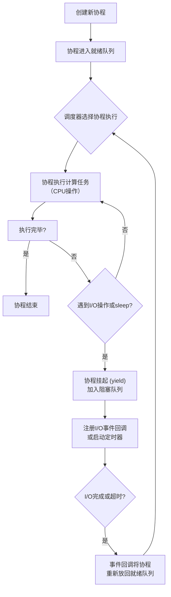

---
{"dg-publish":true,"permalink":"/Work/Script/PHP/Frame/Hyperf/Hyperf 协程解析/","title":"Hyperf 协程解析","tags":["flashcards","#hyperf","#coroutine"],"noteIcon":"","created":"2026-11-05T16:24:21.000+08:00","updated":"2026-11-05T18:35:10.105+08:00","dg-note-properties":{"title":"Hyperf 协程解析","tags":["flashcards","#hyperf","#coroutine"],"reference linking":null}}
---

### 一、协程是什么？
你可以把协程理解为**一种轻量级的线程**，是用户态下的任务调度单位。它由用户代码来调度和管理，而不是由操作系统内核来进行调度。一个 Worker 进程可以拥有大量的协程（例如，默认配置下一个进程最多可创建 100,000 个协程）。
### 二、Hyperf 协程的核心实现
Hyperf 的协程能力主要构建在 **Swoole** 扩展之上。
#### 1. 协作式调度 (Cooperative Scheduling)
Hyperf 的协程调度器采用**协作式调度**。这意味着：
*   **主动让出（Yield）**：协程在执行过程中，若遇到**I/O**操作(Mysql、HTTP、Redis)或 `co::sleep()` 主动休眠，它会**主动让出**当前 CPU 的使用权。
*   **恢复执行（Resume）**：当该协程**等待的I/O操作完成**或**休眠时间到**后，调度器会在合适的时机**恢复其执行**。
#### 2. 协程调度器：智慧的“大脑”
协程调度器就像是协程的“指挥中心”，它主要包含以下几个部分：
*   **就绪队列 (Ready Queue)**：存放那些已经准备好、可以马上被执行的协程。调度器会从这里选择下一个要运行的协程。
*   **阻塞队列 (Blocking Queue)**：存放那些正在等待 I/O 操作完成而暂时挂起的协程。一旦它们等待的事件完成，就会被移回就绪队列。
*   **计时器 (Timer)**：管理协程的睡眠和超时设置。
*   **调度算法**：目前 Hyperf（Swoole）的调度器默认是**协作式**的，主要遵循 **FIFO（先进先出）** 和**事件驱动**的原则。
##### 协程调度器工作流程图


#### 3. 协程的创建
在 Hyperf 中，可以使用 `Coroutine::create()` 来创建协程：
```php
Coroutine::create(function () {
// 你的协程代码
$result = someAsyncOperation();
});
```
### 三、协程间的通信与同步
因为协程是共享内存的，所以当它们需要协作或共享数据时，就需要安全的通信和同步机制。
#### Channel
类似于 Go 语言的 `chan`，为**多生产者**协程和**多消费者**协程模式提供支持。Channel 底层自动实现了协程的切换和调度。
*   `push()`：生产数据。如果通道已满，则协程挂起。
*   `pop()`：消费数据。如果通道为空，则协程挂起，直到有数据到来。
#### WaitGroup
基于 Channel 实现，用于**等待一组协程全部执行完毕**。
```php
use Hyperf\Utils\WaitGroup; // 注意：新版本中可能在 Utils\Coroutine 下

$wg = new WaitGroup();
$wg->add(2); // 计数器加2

Coroutine::create(function () use ($wg) {
	// 任务A
	$wg->done(); // 计数器减1
});

Coroutine::create(function () use ($wg) {
	// 任务B
	$wg->done(); // 计数器减1
});

$wg->wait(); // 阻塞，直到计数器变为0
```
#### Parallel
这是对 WaitGroup 的一个更高级的封装，让你能更方便地**并行执行多个任务并收集结果**。你还可以**限制最大并发数**，防止瞬时并发过高压垮下游服务。
```php
use Hyperf\Utils\Coroutine\Parallel; // 注意：新版本中命名空间可能有所不同

$parallel = new Parallel(5); // 最大并发数限制为5
for ($i = 0; $i < 20; $i++) {
	$parallel->add(function () use ($i) {
		return doSomeJob($i);
	});
}
$results = $parallel->wait(); // 获取所有任务的结果数组
```
#### Concurrent
用于**控制一个代码块内同时运行的最大协程数量**。
```php
use Hyperf\Utils\Coroutine\Concurrent;

$concurrent = new Concurrent(10);
for ($i = 0; $i < 15; ++$i) {
	$concurrent->create(function () {
		// Do something... 最多同时10个协程执行这个代码块
	});
}
```
### 四、透传协程上下文
- **隔离性：** Hyperf Context 是按协程隔离的请求级键值存储；子协程默认不会自动继承创建者协程的 Context。
- **传递挑战：** 中间件写入的用户信息、业务请求号 Request ID，或保存当前 Trace ID、Span ID 和采样标志的 SpanContext，在新建子协程中不能直接读取。
- **追踪应用：** 协程隔离与分布式 Trace 的完整衔接见 [[Work/Tools/Log/分布式日志链路的原理和实践#4.2 Hyperf 子协程上下文\|Hyperf 子协程中的追踪上下文传递]]。
#### 解决方案
##### 显式复制
在创建子协程前保存当前协程 ID，再从创建者协程显式复制允许继承的请求级字段：
```php
$creatorCoroutineId = \Swoole\Coroutine::getCid();

Coroutine::create(function () use ($creatorCoroutineId): void {
	// 只复制该任务需要的请求级字段，避免误传无关或敏感数据。
	Context::copy($creatorCoroutineId, [
		'user_id',
		'request_id',
	]);

	$requestId = Context::get('request_id');
});
```
##### Request ID 与 Trace ID 边界
- **Request ID：** 业务请求号可以在入口缺失时自行生成 UUID，并在子协程间复制。
- **Trace ID：** 必须从当前 OpenTelemetry SpanContext 或合法的 W3C/B3 入站上下文读取。
- **禁止混用：** 不要把带连字符的 UUID v4 当作 W3C Trace ID；W3C Trace ID 是 32 个十六进制字符。
##### 不推荐链式查找
- **能力：** `SwooleCo::getPcid($coId)` 可以沿协程树逐级查找祖先 Context。
- **局限：** 这种做法依赖运行时协程层级，容易把创建者协程与其父协程混淆。
- **推荐：** 优先显式保存创建者协程 ID，并只复制任务需要的字段。
