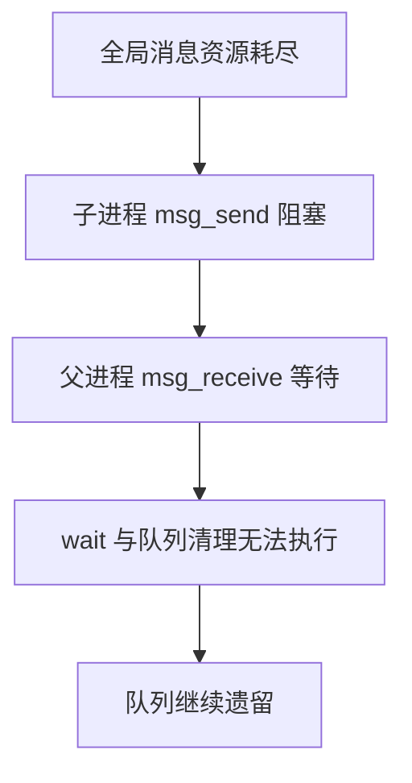
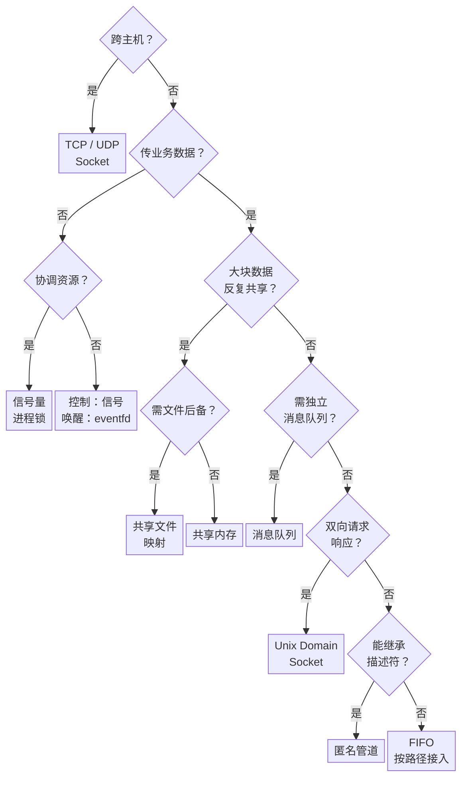

---
{"dg-publish":true,"permalink":"/Work/Script/PHP/Function/Process/IPC/","title":"IPC","tags":["flashcards"],"noteIcon":"","created":"2026-10-29T14:56:30.763+08:00","updated":"2026-11-20T10:49:18.199+08:00","dg-note-properties":{"title":"IPC","tags":["flashcards"],"reference linking":null}}
---

# IPC总览：有哪些方式，区别是什么
**IPC**（==1;;Inter-Process Communication==）是不同进程交换数据、共享状态、协调资源或通知事件的机制。进程通常拥有==1;;独立==地址空间，==1;;不能==直接读写其他进程的普通变量。
## IPC 的常见机制
- **常见类别**：==1;;管道==、==1;;消息队列==、==1;;共享内存==、==1;;信号量==、==1;;信号==、==1;;Socket==、==1;;文件映射==。
## IPC 形式与选型边界
- **形式数量**：管道再分匿名管道和 FIFO，因此下表列 **8** 种形式。
- **先分职责**：管道／队列／Socket 负责传数据，共享内存／文件映射负责共享数据，信号量负责协调，信号负责通知；它们经常组合使用。
- **范围**：以下以 Unix/Linux 和 PHP CLI 为主；不是所有机制都跨主机，也不是所有系统都支持相同 API。

| 方式                | 数据形态／用途    | 决定选型的区别                          |
| ----------------- | ---------- | -------------------------------- |
| **匿名管道 Pipe**     | **单向**字节流  | 通常继承描述符；适合父子进程输出                 |
| **命名管道 FIFO**     | **单向**字节流  | 通过文件路径打开；无亲缘也能通信                 |
| **消息队列**          | 一条条消息      | 保留边界；System V 可按类型接收，POSIX 支持优先级 |
| **共享内存**          | 多进程访问同一内存  | 少复制、适合反复共享大数据；同步另做               |
| **信号量 Semaphore** | 资源计数／同步    | **不传业务数据**；限制同时访问的人数             |
| **信号 Signal**     | 少量**事件通知** | 适合终止／重载；普通信号可能合并                 |
| **Socket**        | 字节流或数据报    | UDS 同机，TCP/UDP 可跨主机；适合双向交互       |
| **共享文件映射 mmap**   | 文件映射到内存    | 可共享修改且有文件后备；可见不等于已落盘             |
- **关系要求**：除==1;;匿名管道==通常靠继承外，其他形式可用于无亲缘进程，但都受权限及资源可访问范围限制。
- **三条分界**：字节流需==1;;自行==分包；共享数据需==1;;协调==并发；发送成功不等于==1;;接收方==处理成功。
## 本目录的学习路线
**创建进程 → 选择 IPC → 协调共享访问 → 处理通知与回收**；按问题跳转，而不是按函数名死记。

| 想弄清的问题 | 去哪里联想 |
| --- | --- |
| **fork 后为何不能直接改变量回传？** | [[Work/Script/PHP/Function/Process/PCNTL#3. 写时复制（Copy-on-Write）\|PCNTL：COW 与独立地址空间]] |
| **外部命令的 stdin/stdout 怎么接？** | [[Work/Script/PHP/Function/Process/PHP Process Management#核心模型\|外部命令：标准流接线]] |
| **谁发信号、谁处理、谁回收？** | [[Work/Script/PHP/Function/Process/POSIX#信号与 FIFO：从操作入口联想到 IPC\|POSIX：发送与创建入口]] → [[Work/Script/PHP/Function/Process/PCNTL#pcntl_signal\|PCNTL：处理信号]] |
| **为何共享计数仍会丢更新？** | [[Work/Script/PHP/Function/Process/SHMOP#多进程共享内存数据竞争问题\|SHMOP：无锁计数与加锁对照]] |
| **只想共享 PHP 缓存，还需手写内存布局吗？** | [[Work/Script/PHP/Function/Process/Apcu#APCu 的核心特性\|APCu：缓存封装与共享范围]] |
<!--SR:!2026-12-04,25,270-->
<?e?>
# 逐项理解与最小示例
- **运行约定**：每段 PHP 示例保存为标题所示文件，执行 `php 文件名.php`；`pcntl`／`posix` 用于进程与信号，System V 示例另需 `sysvmsg`、`sysvshm` 或 `sysvsem`。
- **示例目标**：只演示核心通信链路；PHP 示例默认使用阻塞 I/O，消息队列示例为防止资源耗尽后死锁而明确使用非阻塞收发。真实服务还需处理失败、超时、短写、背压和进程异常退出。
## 1. 匿名管道 Pipe：父子进程的**单向**字节流
- **机制**：写端 → ==1;;内核==缓冲区 → 读端；数据按写入顺序流动，不保留消息边界。
- **适用**：获取子命令输出、父子进程单向传数据。描述符通常由==1;;继承==获得；要双向通信可建两条管道，或改用 Socket。
- **关键边界**：所有==1;;写==端关闭且缓冲区读空，读端才收到 EOF；多留一个写端，读方可能一直等。
- **联想**：先在 [[Work/Script/PHP/Function/Process/PHP Process Management#核心模型\|proc_open 标准流方向]] 区分子进程的 `r/w` 端，再看 [[Work/Script/PHP/Function/Process/PHP Process Management#阻塞、死锁与 SIGPIPE\|缓冲区满与 SIGPIPE]]：读端还开着但不读会阻塞，所有读端关闭后再写才涉及断管道。
### pipe.php：父进程读取子进程输出
```php
// 子进程的标准输出接到管道；w 表示子进程使用写端。
$child = proc_open(
    [PHP_BINARY, '-r', 'echo "hello\n";'],
    [1 => ['pipe', 'w']],
    $pipes
);
// 读取直到子进程关闭输出，预期 hello。
echo stream_get_contents($pipes[1]);
// 关闭读端并回收子进程，避免描述符和进程残留。
fclose($pipes[1]);
proc_close($child);
```
输出
```
hello
```
<!--SR:!2026-11-22,13,230-->
<?e?>
## 2. 命名管道 FIFO：不靠亲缘关系，用路径找到管道
- **机制**：FIFO 全称 **First-In, First-Out（先进先出）**，是文件系统中的特殊节点；路径用于==1;;定位==管道，**数据**实际经过**内核缓冲区**，**不写入**磁盘文件。
- **与 Pipe 区别**：双方独立打开同一==1;;路径==即可通信，**无需继承描述符**；仍是字节流，不自动变成双向请求／响应协议。
- **关键边界**：默认阻塞打开通常要等另一端就绪；不用后删除路径。路径存在不代表消息会==1;;持久==保存。
- **联想**：[[Work/Script/PHP/Function/Process/POSIX#信号与 FIFO：从操作入口联想到 IPC\|posix_mkfifo()]] 只创建入口，后续用文件流 API 打开读写；与匿名管道的区别是**如何找到通道**。
### fifo.php：通过路径打开读写两端
```php
// 用独立临时路径创建 FIFO，示例用父子进程简化启动；无亲缘进程也能打开此路径。
$path = sys_get_temp_dir() . 'ipc-fifo-' . getmypid();
// 创建 FIFO 文件
$fifo = posix_mkfifo($path, 0600);
$pid  = pcntl_fork();
if ($pid == -1) {
    unlink($path);
    throw new RuntimeException('fork failed');
}

// 子进程
if ($pid == 0) {
    // 打开 FIFO 文件, 写端会等待读端打开，发送后关闭，使读方能读到 EOF。
    $fd = fopen($path, 'w');
    // 写入数据
    fwrite($fd, 'hello world');
    // 关闭 FIFO
    fclose($fd);
    // 子进程必须在此退出，否则会继续执行后面的父进程代码，可能导致意想不到的问题
    exit(0);
}
// 父进程, 打开读取 FIFO 文件, 打开读端并消费字节流，预期 hello world。
$fd = fopen($path, 'r');
// 读取 FIFO 文件内容
echo stream_get_contents($fd);
// 关闭 FIFO
fclose($fd);
// 等待子进程退出后移除 FIFO 节点。
pcntl_waitpid($pid, $status);
// 删除 FIFO 文件
unlink($path);
```
输出
```
hello world
```
<!--SR:!2026-11-28,12,230-->
<?e?>
## 3. 消息队列：按消息交付，不自己拆包
- **机制**：发送方 → 内核队列 → 接收方；保留消息边界，发送与接收==1;;不要求==同时进行，但队列容量==1;;有限==。
- **与流区别**：**字节流**只保证字节顺序，应用**需识别每条消息的起止**；**消息队列**由内核**保留边界**，System V 还可按消息类型接收。
- **适用**：本机任务投递、按类别取消息；可用于**无亲缘进程**。内核队列不是磁盘队列，不保证重启后==1;;恢复==；也不自带业务==1;;确认==／失败==1;;重投==。
- **存储与生命周期**：消息保存在操作系统**内核管理的** ==1;;IPC 内存==中，**不对应普通磁盘文件**；创建进程退出后队列仍存在，直到显式==1;;删除==或系统重启。
- **查看状态**：命令行用 `ipcs -q -a`，PHP 用 `msg_stat_queue()`；关键字段见下表。
- **查看内容**：`ipcs` 只显示元数据；System V 队列没有无副作用的消息预览，`msg_receive()` 读取成功就会**消费**消息。
- **容量边界**：单条消息、单队列字节数、系统队列数和系统消息总数分别受限；任一资源耗尽都可能使非阻塞 `msg_send()` 返回 `false`，常见错误为 `EAGAIN`。
### 消息边界
| 对比   | 管道／TCP 等字节流               | System V 消息队列                 |
| ---- | ------------------------- | ----------------------------- |
| 数据形态 | ==1;;连续==字节，没有消息边界        | 一条条==1;;独立==消息，保留边界           |
| 接收结果 | 一次读取可能只有**半**条或包含**多**条消息 | 一次成功接收得到**一条**消息              |
| 应用职责 | 用长度、分隔符等协议==1;;自行==分包     | ==1;;不用==判断起止；仍需处理序列化、长度和业务校验 |
### 消息类型
| 接收时指定的类型 | 选择规则        | 结果                                       |
| -------- | ----------- | ---------------------------------------- |
| `0`      | 不区分类型       | 取队列中==1;;最早==的一条消息                       |
| 正数 `N`   | ==1;;精确==匹配 | 取最早一条类型为 `N` 的消息                         |
| 负数 `-N`  | 范围匹配        | 在类型==1;;小于等于== `N` 的消息中，取类型值==1;;最小==的一条 |
- **定义**：类型是内核随每条消息保存的==1;;正==整数标签，不是 PHP 数据类型、消息 Schema、独立队列或处理状态。
- **作用**：消费者可**跳过**其他类型，只取自己负责的任务；同一类型通常按入队顺序接收，指定不存在的类型时，阻塞接收会继续等待。
- **场景**：可约定 `1=邮件任务`、`2=短信任务`，也可将正整数 ==1;;PID== 用作响应类型，让进程只取自己的响应。
- **顺序影响**：按类型接收可以跳过排在前面的其他类型消息；例如队列依次为 `1:A`、`2:B`、`1:C`，接收类型 `1` 会依次得到 `A`、`C`，`B` 仍留在队列中。
- **能力边界**：类型只提供**简单整数**筛选，不具备 RabbitMQ Routing Key、Kafka Topic/Partition、权限隔离或独立容量。
### 容量与数量限制
| 参数       | 当前值       | 约束对象                               |
| -------- | --------- | ---------------------------------- |
| `msgmax` | `16384 B` | **单条**消息允许的**最大字节数**               |
| `msgmnb` | `2048 B`  | **新队列**的**默认字节容量**，也是普通用户可设置的单队列上限 |
| `msgmni` | `40`      | **系统最多**存在的**消息队列数量**              |
| `msgtql` | `40`      | **全系统最多**同时存在的**消息数量**             |
| `msgssz` | `8 B`     | **内核分配消息**存储时使用的**分段大小**           |
| `msgseg` | `2048`    | **全系统**可用的**消息分段数量**               |
- **查询方式**：macOS 用 `ipcs -Q` 查看系统上限，用 `ipcs -q -a` 查看各队列的 `CBYTES`、`QNUM` 和 `QBYTES`；PHP 用 `msg_stat_queue()` 查看单队列状态，但返回字段因平台而异，当前 Darwin 不提供 `msg_cbytes`。
- **当前环境**：以下是当前 macOS 的实测值，不是跨平台固定标准。
- **实际单条上限**：还要受目标队列**剩余容量**限制；当前默认队列只有 `2048 B`，因此实际可发送的序列化消息通常不能达到 `msgmax=16384 B`。PHP **序列化**本身也占字节，业务数据上限会更小。
- **消息数量**：没有独立的**单队列最多 N 条固定值**；它同时受单队列 `QBYTES`、每条消息大小和全系统 `msgtql` 限制。零长度消息不占 `CBYTES`，仍会消耗消息槽位。
- **当前可调上限**：普通用户调用 `msg_set_queue()` 不能把 `msg_qbytes` 提高到系统 **msgmnb** 以上；当前环境从 `2048 B` 调到 `4096 B` 实测失败。降低容量通常允许，即使新上限低于当前已占用字节数，已有消息仍保留，但后续发送会受限。
- **平台差异**：Linux 常见默认值为 `msgmax=8192 B`、`msgmnb=16384 B`、`msgmni=32000`，应以**目标机器**的 `ipcs -l` 或 `/proc/sys/kernel/msg*` 为准。
- **最高值**：没有可移植的**统一最高值**。Linux 特权用户可调整 `kernel.msgmax`、`kernel.msgmnb`、`kernel.msgmni`，最终仍受内核实现、权限和可用内存约束；macOS 当前未通过标准 `sysctl` 暴露这些消息队列参数，不应依赖运行时任意调大。
- **限制原因**：消息正文和队列元数据占用内核资源；限制可以防止单个进程耗尽系统内存或消息槽位、为生产者提供背压，并提醒应用不要把内核队列当作大文件存储或持久化中间件。
- **选型提示**：大块数据优先考虑共享内存、文件或 Socket；需要持久化、积压和扩展时使用 RabbitMQ、Kafka 等**消息中间件**。
### 阻塞风险
默认阻塞发送若==1;;等不到==资源，子进程会卡在 `msg_send()`；父进程再==1;;阻塞等待==该消息，就会形成双方都无法进入回收代码的等待链。

### 使用场景与选型边界
- **定位**：System V 消息队列是操作系统提供的==1;;单机== IPC，用于本机进程间传递带边界和类型的小消息，不是完整的分布式消息中间件。
- **适用场景**：本地守护进程接收任务、多进程程序内部派发工作、传统 Unix 软件兼容，以及不方便额外部署 Broker 的嵌入式或受限环境。
- **不适用场景**：跨主机通信、重启后恢复消息、业务 ACK、自动重试、死信处理、历史回放、水平扩展和高可用；这些能力需要应用自行实现。
- **关键语义**：`msg_send()` 成功只表示消息==1;;进入==内核队列，不表示消费者已处理成功；进程退出后队列仍可能==1;;遗留==，系统重启后消息则会==1;;丢失==。

| 维度   | System V 消息队列        | RabbitMQ／Kafka                          |
| ---- | -------------------- | --------------------------------------- |
| 通信范围 | ==1;;单机==进程间         | 跨进程、容器和主机                               |
| 存储方式 | 内核内存                 | RabbitMQ 可配置持久化；Kafka 使用持久化日志           |
| 重启恢复 | 不支持                  | 持久化配置正确时支持                              |
| 消费确认 | 无业务 ACK              | RabbitMQ ACK/NACK；Kafka Offset 提交       |
| 失败处理 | 应用自行实现               | 可构建重试和死信流程                              |
| 路由模型 | 按数字消息类型接收            | RabbitMQ Exchange；Kafka Topic/Partition |
| 历史回放 | 不支持                  | Kafka 原生支持；RabbitMQ 通常消费后删除             |
| 水平扩展 | 无集群能力                | 集群、分区或消费者组                              |
| 高可用  | 无副本和故障转移             | 可通过副本、仲裁或集群配置实现                         |
| 运维能力 | `ipcs`、`ipcrm` 等系统工具 | 指标、管理工具和成熟生态                            |
- **RabbitMQ**：更适合后台任务、复杂路由、单条消息确认、重试和死信处理，重点是**可靠投递任务**。
- **Kafka**：更适合事件流、日志、大吞吐、多个消费方独立消费和历史回放，重点是**持久化事件日志**。
- **选择原则**：只解决单机进程间简单传递可考虑 System V；只要涉及分布式、可靠性、扩缩容或可观测性，优先选择成熟消息中间件。
### 是否值得学习
- **需要掌握**：内核存储、消息边界与类型、阻塞行为、容量限制、生命周期、资源清理，以及 `ipcs`／`ipcrm` 的基本排查方法。
- **业务开发**：理解机制和选型边界即可，不必背诵全部 API；Web 与微服务通常直接使用 RabbitMQ、Kafka 等中间件。
- **深入场景**：系统编程、数据库与中间件开发、PHP 多进程服务或遗留 Unix 软件维护，应进一步学习 API、权限、内核限制和异常清理。
- **一句话区分**：System V 解决**单机进程间消息传递**；RabbitMQ 与 Kafka 解决**分布式系统的可靠投递、持久化、扩展和治理**。
### 查询队列状态
| 字段              | 含义                | 排查用途                           |
| --------------- | ----------------- | ------------------------------ |
| `ID`            | 内核分配的**队列标识符**    | `ipcrm -q ID` 按此值删除队列          |
| `KEY`           | 创建或定位队列的**键**     | 判断不同进程是否连接同一队列                 |
| `MODE`          | 所有者、组和其他用户的读写权限   | 排查无权发送或接收的问题                   |
| `OWNER`／`GROUP` | 队列所有者与所属组         | 确认资源归属                         |
| `CBYTES`        | 当前所有消息占用的**总字节数** | 与 `QBYTES` 比较，判断字节容量是否接近上限     |
| `QNUM`          | 当前**未消费**的消息数量    | 判断消息是否积压；对应 PHP 的 `msg_qnum`   |
| `QBYTES`        | 单个队列允许的**最大字节数**  | 队列字节容量上限；对应 PHP 的 `msg_qbytes` |
| `LSPID`         | **最后发送**消息的进程 PID | 定位最近生产者，结合 `ps -p PID` 检查进程    |
| `LRPID`         | **最后接收**消息的进程 PID | 定位最近消费者，结合 `ps -p PID` 检查进程    |
| `STIME`         | 最后成功发送消息的时间       | 判断生产者最近是否仍在发送                  |
| `RTIME`         | 最后成功接收消息的时间       | 判断消费者最近是否仍在消费                  |
| `CTIME`         | 队列创建或属性最后变更时间     | 判断队列是否为长期遗留资源                  |
```bash
# 显示所有 System V 消息队列的容量、消息数和最近收发进程。
ipcs -q -a
IPC status from <running system> as of Fri Oct 30 20:58:09 CST 2026
T  ID  KEY        MODE        OWNER  GROUP  CREATOR   CGROUP CBYTES  QNUM QBYTES LSPID LRPID   STIME    RTIME    CTIME
Message Queues:
q  1   0x6cd36c74 --rw------- wcj    staff  wcj       staff  0       0    2048   0     0       no-entry no-entry 16:58:06
q  2   0x4fef1a9b --rw------- wcj    staff  wcj       staff  0       0    2048   0     0       no-entry no-entry 16:58:17
q  3   0x035eefe2 --rw------- wcj    staff  wcj       staff  0       0    2048   0     0       no-entry no-entry 16:58:30
q  4   0x7a7d7632 --rw------- wcj    staff  wcj       staff  0       0    2048   0     0       no-entry no-entry 16:58:39

# 确认队列已无业务用途后，按队列 ID 删除；该操作会丢弃其中的消息。
ipcrm -q 1
```
### queue.php：子进程发送，父进程按类型接收
```php
// 1. 随机键用于隔离本次实验；实际独立进程需约定同一个固定键。
$key = random_int(1, 0x7fffffff);

// 2. 获取或创建对应键的队列，0600 表示仅当前用户可读写。
$queue = msg_get_queue($key, 0600);

// 3. fork 后父子进程都持有指向同一个内核消息队列的对象。
$pid = pcntl_fork();
if ($pid === -1) {
    // fork 失败时没有子进程可处理消息，立即删除刚创建的队列。
    msg_remove_queue($queue);
    throw new RuntimeException('fork failed');
}

if ($pid === 0) {
    // 4. 子进程发送一条类型为 2 的消息：
    //    true 让 PHP 先序列化 hello；false 让资源不足时立即失败而非阻塞。
    $sent = msg_send(
        $queue,  // 要发送的队列
        2,       // 消息类型
        'hello', // 要发送的消息内容
        true,    // 先序列化消息，再发送
        false,   // 资源不足时立即失败，不永久阻塞
        $errorCode // 输出：发送失败时的系统错误码
    );
    if (!$sent) {
        // errorCode 可用于识别 EAGAIN 等内核错误。
        fwrite(STDERR, "msg_send failed: {$errorCode}\n");
    }

    // 退出码把发送结果传给父进程：0 表示成功，1 表示失败。
    // 子进程必须在此退出，否则会继续执行后面的父进程代码，可能导致意想不到的问题
    exit($sent ? 0 : 1);
}

try {
    // 5. 父进程先等待并回收子进程，避免发送尚未完成就尝试非阻塞接收。
    pcntl_waitpid($pid, $status);

    // 只有子进程正常退出且退出码为 0，才说明消息已成功进入队列。
    if (!pcntl_wifexited($status) || pcntl_wexitstatus($status) !== 0) {
        throw new RuntimeException('child failed to send message');
    }

    // 6. 只接收类型 2：其他类型即使更早入队，也会继续留在队列中。
    $received = msg_receive(
        $queue,         // 要读取的队列
        2,              // 期望的消息类型
        $type,          // 输出：实际收到的消息类型
        1024,           // 单条消息允许接收的最大字节数
        $message,       // 输出：反序列化后的消息内容
        true,           // 使用 PHP 反序列化，还原 msg_send() 序列化的数据
        MSG_IPC_NOWAIT, // 没有匹配消息时立即失败，不永久阻塞
        $errorCode      // 输出：接收失败时的系统错误码
    );
    if (!$received) {
        throw new RuntimeException("msg_receive failed: {$errorCode}");
    }

    // 7. 预期输出 hello；一次成功接收只消费一条完整消息。
    echo $message, PHP_EOL;
} finally {
    // 8. 无论接收成功还是抛出异常，都由父进程删除内核队列。
    //    普通进程退出不会自动删除 System V 队列。
    msg_remove_queue($queue);
}
```
输出
```
hello
```
<!--SR:!2026-12-16,26,230-->
<?e?>
## 4. 共享内存：共享数据，不经过反复收发
- **机制**：多个进程将同一内存区域关联到各自地址空间，减少反复经过内核缓冲区的==1;;复制==；适合共享大缓冲区、频繁访问的状态。
- **与队列区别**：**没有自动收发**、消息边界或并发协议；需自行管理数据布局与==1;;同步==，不是无条件最快。
- **PHP 区别**：`shm_*` 按**变量**读写且有序列化；`shmop_*` 按==1;;字节==读写。PHP 接口仍可能复制数据，不能直接等同原生零复制。
- **联想 COW**：[[Work/Script/PHP/Function/Process/PCNTL#3. 写时复制（Copy-on-Write）\|fork 继承普通变量]] 后，修改通常只影响自己；真正跨进程共享要显式使用共享段。
- **联想应用层**：需要字节布局看 [[Work/Script/PHP/Function/Process/SHMOP#PHP 主子进程共享内存\|SHMOP]]；需要键值缓存看 [[Work/Script/PHP/Function/Process/Apcu#APCu 的核心特性\|APCu]]，其共享范围受运行实例与内存区限制，并非所有独立 CLI 都互通。
### shared.php：子进程写共享变量，父进程读取
```php
// 创建共享段，变量编号 1 与共享段的键是两个概念。
$shm = shm_attach(random_int(1, 0x7fffffff), 4096, 0600);
$pid = pcntl_fork();
if ($pid === -1) {
    shm_remove($shm); // 从Unix系统中移除共享内存
    shm_detach($shm); // 断开共享内存段的连接
    throw new RuntimeException('fork failed');
}
if ($pid === 0) {
    // 写入编号 1 的共享变量；子进程退出前只解除自己的关联。
    shm_put_var($shm, 1, 'hello');
    shm_detach($shm);
    exit; // 子进程必须在此退出，否则会继续执行后面的父进程代码，可能导致意想不到的问题
}
// 等子进程写完再读，预期 hello；此例靠 wait 排序，没有并发读写。
pcntl_waitpid($pid, $status);
echo shm_get_var($shm, 1), PHP_EOL;
// 标记删除共享段，再解除父进程关联。
shm_remove($shm);
shm_detach($shm);
```
输出
```
hello
```
- **并发读改写**：如两个进程同时执行“读计数 → 加一 → 写回”，仅共享内存仍会丢更新；需用下节信号量或进程共享锁包住整个操作。
<!--SR:!2026-12-05,24,250-->
<?e?>
## 5. 信号量：控制多少进程能进入临界区
- **机制**：==1;;计数==器；P 获取一个许可，不足时等待，V 归还许可；获取和释放是原子操作。
- **与信号区别**：信号量用于资源==1;;协调==，不发送通知载荷；上限为 1 可实现互斥，上限为 N 可允许 N 个参与者进入。
- **适用**：保护共享数据、限制并发资源使用。共享内存负责数据，信号量负责==1;;同步==，两者可以组合。
- **联想实验**：[[Work/Script/PHP/Function/Process/SHMOP#多进程共享内存数据竞争问题\|3 个进程各加 100 次]]，期望 `300`，无锁可能不足；[[Work/Script/PHP/Function/Process/SHMOP#解决方案：使用信号量互斥锁\|用信号量包住读改写]] 后才避免丢更新。
### semaphore.php：两个进程串行进入临界区
```php
// 同一个 System V 信号量，最多允许 1 个进程持有；true 启用退出时自动释放。
$sem = sem_get(random_int(1, 0x7fffffff), 1, 0600, true);
$pid = pcntl_fork();
if ($pid === -1) {
    sem_remove($sem);
    throw new RuntimeException('fork failed');
}
// 父子进程都执行本段：预期每组 enter/leave 不被另一进程插入。
sem_acquire($sem);
try {
    echo getmypid(), " enter\n";
    usleep(100000);
    echo getmypid(), " leave\n";
} finally {
    sem_release($sem);
}
// 父进程确认子进程也执行完后，才删除信号量。
if ($pid === 0) {
    exit; // 子进程必须在此退出，否则会继续执行后面的父进程代码，可能导致意想不到的问题
}
pcntl_waitpid($pid, $status);
sem_remove($sem);
```
输出
```
27612 enter
27612 leave
27617 enter
27617 leave
```
<!--SR:!2026-11-30,20,250-->
<?e?>
## 6. 信号：通知进程发生了事件
- **机制**：向进程发送==1;;异步==事件通知，常见用途是终止、重载配置、回收子进程；不是唯一能异步交互的 IPC。
- **与消息队列区别**：普通信号可能==1;;合并==，不能当可靠消息队列或计数器；实时信号可排队并带少量附加数据，但也有资源限制。
- **例子**：`Ctrl+C` 通常向前台进程组发送 ==1;;SIGINT==；Linux `eventfd` 更适合接入事件循环做计数式唤醒，不用于传大数据。
- **联想链**：[[Work/Script/PHP/Function/Process/POSIX#信号与 FIFO：从操作入口联想到 IPC\|posix_kill() 发送]] → [[Work/Script/PHP/Function/Process/PCNTL#pcntl_signal\|pcntl_signal() 注册处理器]]；收到 `SIGCHLD` 后仍需 [[Work/Script/PHP/Function/Process/PCNTL#pcntl_wait vs pcntl_waitpid\|wait/waitpid 回收]]，通知不等于已回收。
### signal.php：父进程通知子进程退出
```php
// 在 fork 前安装处理器，避免父进程发信号时子进程尚未准备好。
pcntl_async_signals(true);
pcntl_signal(SIGUSR1, function () {
    echo "notified\n";
    exit;
});
$pid = pcntl_fork();
if ($pid === -1) {
    throw new RuntimeException('fork failed');
}
if ($pid === 0) {
    // 等待事件；收到 SIGUSR1 后执行处理器并退出。
    while (true) {
        sleep(1);
    }
}
// 发送通知并回收子进程，预期 notified。
posix_kill($pid, SIGUSR1);
pcntl_waitpid($pid, $status);
```
输出
```
notified
```
<!--SR:!2026-11-23,10,230-->
<?e?>
## 7. Socket：同机和跨机的双向通信
- **地址范围**：==1;;Unix== Domain Socket（UDS）用于同机；TCP/UDP Socket 可跨主机，不要求进程有亲缘关系。
- **数据语义**：TCP／流式 UDS 是字节流，要自行定义消息==1;;边界==；UDP／数据报 UDS 保留消息边界。TCP 可靠有序不等于业务已处理。
- **适用**：请求／响应、双向协议、服务间通信；同机服务通常先考虑 UDS。UDP 不保证==1;;送达==或顺序，适合能容忍丢包或自建可靠性的场景。
- **PHP 抽象**：Socket 决定**底层**通信能力，PHP 可用 `socket_*` 直接控制套接字，也可用 Stream 将 Socket 统一成 `fread()`／`fwrite()` 可操作的流；两者的层次与取舍见 [[Work/Script/PHP/Function/Socket、Stream#Stream vs Socket\|Socket、Stream]]。
- **协议演进**：TCP Socket 只提供**可靠字节流**；在其上完成 HTTP Upgrade、WebSocket 分帧和长连接事件处理后，才成为可双向推送的 [[Work/Script/PHP/Swoole/利用Swoole实现PHP+websocket直播、及时通讯#WebSocket 原理\|Swoole WebSocket 服务]]。
- **联想继承**：`socketpair()` 在 fork 前创建，父子继承端点后各关不用的一端；继承机制见 [[Work/Script/PHP/Function/Process/PCNTL#2. 完美的副本\|PCNTL：文件描述符继承]]。独立进程则通过监听地址建立连接。
### socket.php：UDS socketpair 双向请求／响应
```php
// 创建一对已连接的本地流式 Socket；独立服务可用 Unix 路径监听来接入无亲缘进程。
$pair = stream_socket_pair(STREAM_PF_UNIX, STREAM_SOCK_STREAM, 0);
$pid  = pcntl_fork();
if ($pid === -1) {
    throw new RuntimeException('fork failed');
}
if ($pid === 0) {
    // 子进程发送一行请求，再读取一行响应；本例用换行符分包。
    fclose($pair[0]);
    fwrite($pair[1], "child ping\n");
    echo fgets($pair[1]);
    fclose($pair[1]);
    exit; // 子进程必须在此退出，否则会继续执行后面的父进程代码，可能导致意想不到的问题
}
// 父进程读取请求并回复，最终输出 ping、pong。
fclose($pair[1]);
echo fgets($pair[0]);
fwrite($pair[0], "parent pong\n");
fclose($pair[0]);
pcntl_waitpid($pid, $status);
```
输出
```
child ping
parent pong
```
- **读取边界**：本例用换行符分包，因此选择 `fgets()`；它与等待 EOF 的 `stream_get_contents()` 有何区别，以及错误替换为何可能互等，统一见 [[Work/Script/PHP/Function/Socket、Stream#fgets() vs stream_get_contents()\|Stream 读取边界]]。
### tcp.php：两个独立进程通过 TCP 通信
```php
// 终端 A：php tcp.php server；先监听，再接受一个连接。
$address = 'tcp://127.0.0.1:19091';
if (($argv[1] ?? '') === 'server') {
    $server = stream_socket_server($address);
    $client = stream_socket_accept($server, 10);
    fwrite($client, 'reply: ' . fgets($client));
    fclose($client);
    fclose($server);
} else {
    // 终端 B：php tcp.php；预期 reply: ping。跨机时改地址并检查监听与网络权限。
    $client = stream_socket_client($address);
    fwrite($client, "ping\n");
    echo fgets($client);
    fclose($client);
}
```
输出
```
reply: ping
```
<!--SR:!2026-11-30,20,250-->
<?e?>
## 8. 共享文件映射：像访问内存一样访问文件
- **机制**：`mmap` 把文件映射进进程地址空间；==1;;共享==映射（`MAP_SHARED`）可让修改被其他共享映射者看到，私有映射（`MAP_PRIVATE`）的修改不这样共享。
- **与共享内存区别**：关注是否需要==1;;文件==后备、重新打开和==1;;持久==存储；两类机制实现上可能重叠，不是绝对互斥的分类。
- **关键边界**：修改对另一进程可见，不等于已==1;;落盘==；按需求使用同步／刷盘机制，并单独处理并发一致性。
- **PHP 边界**：普通 `fopen()` 不等于 `mmap`；标准 PHP 没有通用 `mmap()` 函数，需扩展／FFI。下例用原生 C 展示真实映射，避免把普通文件读写误当成映射。
### mmap.c：子进程改共享映射，父进程读取
```c
#include <stdio.h>
#include <stdlib.h>
#include <unistd.h>
#include <sys/mman.h>
#include <sys/wait.h>

enum {
    MAP_SIZE = 4096,
    MESSAGE_SIZE = 5
};

int main(void) {
    // 1. 创建唯一临时文件。mkstemp() 会替换末尾的 X，并返回已打开的文件描述符。
    char path[] = "/tmp/ipc-map-XXXXXX";
    int fd = mkstemp(path);
    if (fd == -1) {
        perror("mkstemp");
        return EXIT_FAILURE;
    }

    // 2. 先把文件扩展到映射长度，避免访问超出文件有效范围的页面。
    if (ftruncate(fd, MAP_SIZE) == -1) {
        perror("ftruncate");
        close(fd);
        unlink(path);
        return EXIT_FAILURE;
    }

    // 3. 建立可读写的共享映射。MAP_SHARED 使父子进程看到同一组修改。
    char *shared = mmap(
        NULL,
        MAP_SIZE,
        PROT_READ | PROT_WRITE,
        MAP_SHARED,
        fd,
        0
    );
    if (shared == MAP_FAILED) {
        perror("mmap");
        close(fd);
        unlink(path);
        return EXIT_FAILURE;
    }

    // 4. fork() 后，父子进程继承文件描述符和同一份共享映射。
    pid_t pid = fork();
    if (pid == -1) {
        perror("fork");
        munmap(shared, MAP_SIZE);
        close(fd);
        unlink(path);
        return EXIT_FAILURE;
    }

    if (pid == 0) {
        // 5. 子进程直接写映射内存，不调用 write() 修改文件。
        snprintf(shared, MAP_SIZE, "hello");

        // MAP_SHARED 已让父进程可见修改；MS_SYNC 额外等待脏页写回文件后备存储。
        int syncResult = msync(shared, MAP_SIZE, MS_SYNC);
        if (syncResult == -1) {
            perror("msync");
        }

        // 子进程只释放自己的映射和描述符；临时文件由父进程最终删除。
        munmap(shared, MAP_SIZE);
        close(fd);
        _exit(syncResult == -1 ? EXIT_FAILURE : EXIT_SUCCESS);
    }

    // 6. 父进程等待子进程写入和刷盘完成，避免在数据就绪前读取。
    int status;
    int result = EXIT_FAILURE;
    if (waitpid(pid, &status, 0) == -1) {
        perror("waitpid");
        goto cleanup;
    }
    if (!WIFEXITED(status) || WEXITSTATUS(status) != EXIT_SUCCESS) {
        fprintf(stderr, "child process failed\n");
        goto cleanup;
    }

    // 7. 从共享映射读取，验证父进程已经看到子进程写入的内容。
    printf("map=%s\n", shared);

    // pread() 从文件偏移 0 读取，但不会改变文件描述符当前偏移量。
    char fileData[MESSAGE_SIZE + 1] = {0};
    ssize_t bytesRead = pread(fd, fileData, MESSAGE_SIZE, 0);
    if (bytesRead != MESSAGE_SIZE) {
        if (bytesRead == -1) {
            perror("pread");
        } else {
            fprintf(stderr, "short read: %zd bytes\n", bytesRead);
        }
        goto cleanup;
    }
    printf("file=%s\n", fileData);
    result = EXIT_SUCCESS;

cleanup:
    // 8. 父进程统一解除映射、关闭描述符，并删除临时文件路径。
    munmap(shared, MAP_SIZE);
    close(fd);
    unlink(path);
    return result;
}
```
输出
```shell
# 保存为 mmap.c 后编译运行，预期 map=hello 和 file=hello。
cc mmap.c -o mmap-demo && ./mmap-demo
map=hello
file=hello
```
<!--SR:!2026-11-21,12,230-->
<?e?>
# 总结：IPC 选型流程
- **读法**：从顶部开始，沿菱形的“是／否”分支到方案；通信目的、本地数据与字节流已合并为一张图。
- **组合关系**：数据通道与协调工具可以叠加，如共享内存 + 信号量；以下是起点选择，最终按数据量、延迟、可靠性与可维护性验证。
## 合并选型流程

## 最后核对
- **队列还是 Socket**：想按消息类别／优先级取任务，且不保持连接，考虑队列；想双向请求／响应或跨机通信，考虑 Socket。
- **管道还是共享内存**：小数据顺序传递先用管道／Socket；反复交换大数据、复制成本确实成为瓶颈，再考虑共享内存。
- **文件映射不是可靠队列**：需要业务确认、重投、跨机消费或故障恢复时，进一步评估消息中间件，而非把内核队列或映射文件直接当成它。
- **上线前检查**：权限、分包、超时／背压、并发同步、对端退出、资源清理；匿名管道／Socket 要关端点，System V 对象与 FIFO 路径要按所有权删除。
# 深入阅读
- **Unix 机制**：《Unix 环境高级编程》（APUE，Stevens / Rago）；《Unix 网络编程 卷2：进程间通信》（Stevens）。
- **Linux 实践**：《Linux/UNIX 系统编程手册》（Michael Kerrisk）；结合相应 `man` 手册核对边界。
- **理论与同步**：《现代操作系统》（Tanenbaum）；《C++ Concurrency in Action》（Williams，侧重线程，线程通信不等同 IPC）。
