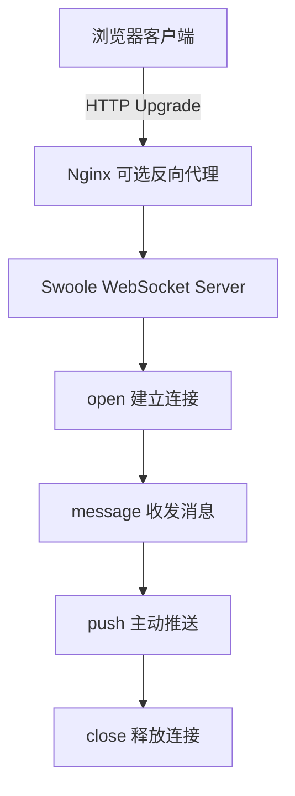

---
{"dg-publish":true,"permalink":"/Work/Script/PHP/Swoole/利用Swoole实现PHP+websocket直播、及时通讯/","title":"利用Swoole实现PHP+websocket直播、及时通讯","tags":["flashcards"],"noteIcon":"","created":"2026-11-02T14:44:09.953+08:00","updated":"2026-11-02T14:44:28.780+08:00","dg-note-properties":{"title":"利用Swoole实现PHP+websocket直播、及时通讯","tags":["flashcards"],"reference linking":null}}
---

# 整体链路
WebSocket 负责浏览器与服务端之间的**全双工长连接**，Swoole 负责监听连接、处理事件并向客户端推送消息。完整链路为：

- **底层能力**：TCP Socket 只提供可靠字节流；它在 IPC 中的选型边界见 [[Work/Script/PHP/Function/Process/IPC#7. Socket：同机和跨机的双向通信\|Socket 的同机与跨机通信能力]]。
- **PHP 抽象**：PHP 可直接操作 Socket，也可通过 Stream 统一读写；两者的层次与取舍见 [[Work/Script/PHP/Function/Socket、Stream#Stream vs Socket\|Socket 与 Stream 的抽象差异]]。
- **Swoole 职责**：Swoole 在底层事件循环之上提供 WebSocket 握手、分帧、连接管理与事件回调。
# WebSocket 原理
## 协议定位
- **WebSocket**：建立在 TCP 之上的**应用层双向通信协议**，连接建立后客户端和服务端都能主动发送消息。
- **HTTP 的作用**：WebSocket 使用一次 HTTP/1.1 请求完成**协议升级**；升级成功后，后续数据按 WebSocket 帧传输，不再是普通 HTTP 请求／响应。
- **TCP 的作用**：HTTP Upgrade 之前必须先建立 TCP 连接。TCP 三次握手与 WebSocket 握手是两个不同层次，不能称为“HTTP 三次握手”。
- **连接状态**：WebSocket 是有状态长连接，但这不等于业务状态自动可靠保存；身份、房间、订阅关系和离线消息仍需应用维护。
> **记忆点：** WebSocket 协议升级成功的 HTTP 状态码是 **`101 Switching Protocols`**。
## TCP 建连与 HTTP 升级
TCP 先通过 **SYN → SYN-ACK → ACK** 建立可靠连接：
1. 客户端发送 `SYN` 和初始序列号。
2. 服务端返回 `SYN-ACK`，确认客户端序列号并给出自己的序列号。
3. 客户端返回 `ACK`，TCP 连接建立。

TCP 建连后，客户端发送带升级请求头的 HTTP 请求：
```http
GET /chat HTTP/1.1
Host: example.com
Upgrade: websocket
Connection: Upgrade
Sec-WebSocket-Key: <随机值>
Sec-WebSocket-Version: 13
```
服务端接受升级后返回：
```http
HTTP/1.1 101 Switching Protocols
Upgrade: websocket
Connection: Upgrade
Sec-WebSocket-Accept: <校验值>
```
协议关系如下：

## Ajax 轮询、长轮询与 WebSocket
| 方案 | 连接方式 | 服务端推送 | 主要代价 | 适用场景 |
| --- | --- | --- | --- | --- |
| **Ajax 轮询** | 客户端定时重复请求 | 伪推送 | 空请求多、实时性取决于间隔 | 低频状态查询 |
| **长轮询** | 请求保持到有消息或超时 | 响应后立即重连 | 连接与重连开销仍存在 | 兼容旧环境的消息通知 |
| **WebSocket** | 升级后保持双向长连接 | 原生支持 | 需维护连接、心跳、背压与扩容 | IM、协作、游戏、实时看板 |
### Ajax 轮询
客户端每隔固定时间发起请求，即使没有新消息也会消耗一次请求。轮询间隔越短，**实时性越高**，但服务器与网络开销也越大。
```javascript
const timer = setInterval(async () => {
    const response = await fetch('/messages');
    const messages = await response.json();
    receive(messages);
}, 1000);
```
### 长轮询
服务端在没有新消息时暂不返回；收到消息或达到超时时间后响应，客户端随后再次建立请求。它减少了空轮询，但仍依赖**响应后重连**。
```javascript
async function longPoll() {
    try {
        const response = await fetch('/messages/long-poll');
        receive(await response.json());
    } finally {
        longPoll();
    }
}

longPoll();
```
### WebSocket
WebSocket 完成协议升级后复用同一条连接。服务端有新消息时可直接 `push`，无需等待客户端再次发起 HTTP 请求。
- **优势**：低延迟、双向通信、减少重复请求头和频繁建连。
- **代价**：服务端必须处理连接生命周期、心跳、慢客户端、发送队列、断线重连和多实例路由。
# Swoole WebSocket 运行模型
## 事件生命周期
`Swoole\WebSocket\Server` 的核心事件顺序是：
1. **`open`**：HTTP Upgrade 成功，连接进入可通信状态。
2. **`message`**：收到完整 WebSocket 帧，可读取连接 ID 和消息数据。
3. **`push`**：服务端主动向一个已建立连接的客户端发送数据。
4. **`close`**：客户端关闭、网络断开或服务端主动关闭连接，释放关联状态。
Swoole 的 **Reactor** 负责网络事件，**Worker** 执行 PHP 回调；进程与线程职责见 [[Work/Script/PHP/Swoole/Swoole 线程、进程模型#2.1 多进程架构\|Swoole 多进程架构]]。因此不能假设不同 Worker 共享普通 PHP 数组，跨 Worker 的用户、房间和订阅状态应放入合适的共享存储。
## 最小广播服务器
以下服务器把收到的消息广播给所有已建立连接的客户端：
```php
use Swoole\Http\Request;
use Swoole\WebSocket\Frame;
use Swoole\WebSocket\Server;

$server = new Server('0.0.0.0', 9502);

$server->on('open', function (Server $server, Request $request): void {
    echo "client {$request->fd} connected\n";
});

$server->on('message', function (Server $server, Frame $frame): void {
    foreach ($server->connections as $fd) {
        if ($server->isEstablished($fd)) {
            $server->push($fd, $frame->data);
        }
    }
});

$server->on('close', function (Server $server, int $fd): void {
    echo "client {$fd} closed\n";
});

$server->start();
```
- **监听地址**：`0.0.0.0` 表示监听所有网卡，不是浏览器实际连接地址；客户端应使用可访问的域名或 IP。
- **连接标识**：`fd` 只用于当前 Server 实例中的连接定位，不能直接当作稳定用户 ID。
- **广播边界**：生产环境应按用户、房间或主题筛选连接，并处理发送失败与慢客户端，不能无条件全量广播。
# 安装与运行
## 安装扩展
以下以 PECL 安装为例；具体 PHP 与 Swoole 版本兼容性应以目标版本官方文档为准：
```shell
# 编译并安装当前可用的稳定版 Swoole 扩展。
pecl install swoole

# 将扩展加入 CLI 使用的 php.ini；实际配置文件位置可用 php --ini 查询。
printf 'extension=swoole.so\n' > /path/to/php/conf.d/50-swoole.ini

# 确认 CLI 已加载扩展并查看版本、编译参数与功能。
php --ri swoole
```
## 运行服务器
```shell
# 前台启动，便于观察连接、消息和关闭事件。
php server.php
```
- **运行模式**：WebSocket Server 是常驻进程，应使用 CLI 启动，不能按普通 PHP-FPM 请求脚本理解。
- **端口开放**：确认防火墙、安全组和反向代理允许访问监听端口。
- **历史版本**：旧资料中的 `swoole_websocket_server` 和 PHP 5 示例只适合阅读历史 API；新代码优先使用命名空间类。
# 即时通信示例
## 浏览器聊天客户端
该页面连接广播服务器，展示连接状态、发送文本并接收其他客户端消息：
```html
<!DOCTYPE html>
<html lang="zh-CN">
<head>
    <meta charset="UTF-8">
    <title>WebSocket Chat</title>
</head>
<body>
<div id="status">connecting</div>
<div id="messages"></div>
<input id="text" type="text">
<button id="send" type="button">发送</button>
<script>
    const status = document.getElementById('status');
    const messages = document.getElementById('messages');
    const input = document.getElementById('text');
    const socket = new WebSocket('ws://127.0.0.1:9502');

    socket.addEventListener('open', () => {
        status.textContent = 'connected';
    });

    socket.addEventListener('message', (event) => {
        const item = document.createElement('div');
        item.textContent = event.data;
        messages.appendChild(item);
    });

    socket.addEventListener('close', () => {
        status.textContent = 'closed';
    });

    document.getElementById('send').addEventListener('click', () => {
        if (socket.readyState === WebSocket.OPEN && input.value !== '') {
            socket.send(input.value);
            input.value = '';
        }
    });
</script>
</body>
</html>
```
## 从演示到真实 IM
广播示例只证明**长连接收发链路**，真实 IM 还需补齐：
- **身份认证**：Upgrade 前后校验 Token，并把业务用户 ID 与连接绑定。
- **会话路由**：维护用户、设备、会话和连接之间的映射，而不是只记录 `fd`。
- **消息可靠性**：设计消息 ID、确认、重试、去重、顺序和离线存储。
- **连接保活**：使用 Ping/Pong 或业务心跳检测失效连接，客户端采用带退避的断线重连。
- **多实例扩展**：连接分布在不同实例时，通过 Redis、消息队列或网关完成跨实例路由。
真实业务中，客户端通常先向业务服务取得凭证，再与 IM 服务建立 WebSocket 连接；可继续对照 [[Work/Project/IM/接口文档/概要设计#项目客户端\|IM 客户端、业务服务与基础服务的职责划分]]。
# 图像直播演示
## 方案定位
浏览器把摄像头画面定时绘制到 Canvas，再通过 WebSocket 发送 JPEG 数据，服务端转发给观看端。该方案适合**教学演示或低帧率预览**，不等同于生产视频直播：
- Base64 会增加传输体积，频繁截图还会占用浏览器 CPU。
- WebSocket 不提供音视频编码、码率自适应、抖动缓冲和媒体同步。
- 正式直播优先使用 WebRTC、HLS、HTTP-FLV 等媒体方案，WebSocket 更适合信令、弹幕和控制消息。
## 主播页面
页面获取摄像头画面，每 `100 ms` 截取一张 JPEG 并发送，理论上限约 **10 帧／秒**；实际帧率受编码和网络耗时影响。
```html
<!DOCTYPE html>
<html lang="zh-CN">
<head>
    <meta charset="UTF-8">
    <title>WebSocket Camera Sender</title>
</head>
<body>
<video id="video" autoplay muted playsinline width="640" height="480"></video>
<canvas id="canvas" width="640" height="480" hidden></canvas>
<script>
    const socket = new WebSocket('ws://127.0.0.1:9502');
    const video = document.getElementById('video');
    const canvas = document.getElementById('canvas');
    const context = canvas.getContext('2d');

    navigator.mediaDevices.getUserMedia({video: true, audio: false})
        .then((stream) => {
            video.srcObject = stream;
        });

    const timer = setInterval(() => {
        if (socket.readyState !== WebSocket.OPEN || video.readyState < 2) {
            return;
        }

        context.drawImage(video, 0, 0, canvas.width, canvas.height);
        socket.send(canvas.toDataURL('image/jpeg', 0.5));
    }, 100);

    socket.addEventListener('close', () => clearInterval(timer));
</script>
</body>
</html>
```
## 观看页面
观看端接收服务端广播的 Data URL，并更新图片：
```html
<!DOCTYPE html>
<html lang="zh-CN">
<head>
    <meta charset="UTF-8">
    <title>WebSocket Camera Viewer</title>
</head>
<body>

<script>
    const receiver = document.getElementById('receiver');
    const socket = new WebSocket('ws://127.0.0.1:9502');

    socket.addEventListener('message', (event) => {
        receiver.src = event.data;
    });
</script>
</body>
</html>
```
# 生产部署与风险
## Nginx 反向代理
生产环境通常由 Nginx 终止 TLS，并把 `wss://` 请求转发给 Swoole。代理必须保留 `Upgrade` 与 `Connection` 请求头；完整配置入口见 [[Work/Server/Nginx/Nginx basic\|Nginx WebSocket 反向代理配置]]。
```nginx
location /ws/ {
    proxy_pass http://127.0.0.1:9502;
    proxy_http_version 1.1;
    proxy_set_header Upgrade $http_upgrade;
    proxy_set_header Connection "upgrade";
    proxy_set_header Host $host;
    proxy_read_timeout 60s;
}
```
## 上线检查
- **安全**：使用 `wss://`，校验 Origin、Token、消息权限和输入大小，限制连接频率。
- **心跳**：为 Ping/Pong 或业务心跳设置超时，及时清理半开连接。
- **背压**：限制单连接发送队列与消息速率，慢客户端不能无限占用内存。
- **状态**：不要只把连接关系放在单个 Worker 的普通数组中；明确跨 Worker、跨实例的数据归属。
- **可观测性**：记录连接数、建连失败、异常关闭、消息吞吐、发送失败和事件循环延迟。
- **优雅退出**：发布或重启时停止接收新连接，通知客户端重连，并给在途消息留出处理时间。
# 总结
- **WebSocket** 通过 HTTP Upgrade 在 TCP 连接上建立全双工消息通道，成功升级状态码为 `101`。
- **Swoole** 用事件循环和 Worker 回调管理连接，`open → message/push → close` 构成核心生命周期。
- **即时通信** 的难点不只是发送消息，还包括认证、路由、可靠性、心跳、背压和多实例扩展。
- **图像直播示例** 只是低帧率截图广播；正式音视频直播应使用专门的媒体协议与基础设施。
